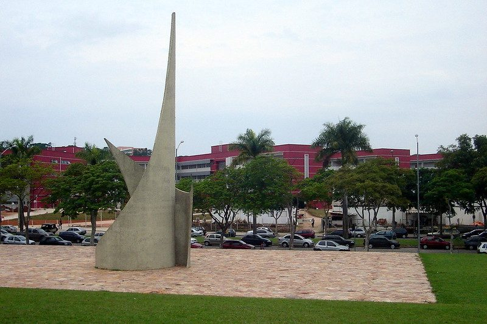

O ano era 1972, Belo Horizonte, uma cidade em crescimento, vivia a efervescência dos anos de petróleo barato e do progresso sob rodas. Camada a camada, áreas verdes eram trocadas por jardins de asfalto que prometiam trazer o futuro, ao custo da perda de algumas árvores, porém, havia tantas! 

Nessa mesma época, a UFMG crescia. Cursos que antes ocupavam edifícios no centro passavam para o campus Pampulha. Seu vizinho, o Mineirão, construído sob terreno cedido pela universidade, abrigava grandes jogos de futebol. Muito esporadicamente, durante os anos 70, aquela Pampulha quase vazia, aquela Pampulha que se viajava para chegar, recebia algumas raras corridas semi-amadoras, com semi-profissionais, que rasgavam a subida do Mineirão e faziam a sua famosa curva, amontoando pequenas multidões. Os alunos da universidade, ali perto, conviviam com o barulho dos carrões de outros tempos, em pegas ilegais e muitas vezes fatais, esses sim bastante comuns, enquanto tentavam se concentrar na aula. A vida era aquilo. Qual problema teria? Todo mundo sonhava em ter um Opalão. 

E os tempos passaram, os sonhos mudaram e BH também. 

A universidade cresceu muito. Um de seus prédios, recém-construído nos anos 1970, o ICB, que está a 100 metros daquela famosa curva do Mineirão, hoje abriga os maiores laboratórios de pesquisa biológica do país. Lá é o local de trabalho de 15 dos cientistas mais influentes do mundo. Suas pesquisas, realizadas em parceria com mais de 5 mil estudantes de graduação e pós-graduação e com corpo de funcionários, produzem mais de 15 mil artigos científicos e 233 patentes (Dados de 2015)! 

Grande parte dessas pesquisas envolve aquilo em que os cientistas do ICB são especialistas: Tecnologia de ponta no estudo com animais de laboratório, super sensíveis e frágeis, cuidados com esmero, e fundamentais para o desenvolvimento de vacinas, remédios, tratamentos médicos, cura de doenças, levantamento da biodiversidade e avanço da ciência no Brasil e do mundo. Acompanhamos recentemente o desenvolvimento da vacina Calixcoca, vacina terapêutica para o tratamento da dependência em cocaína, premiada internacionalmente, o desenvolvimento da vacina contra a transmissão da leishmaniose em 2016, e a spintech contra a covid-19… tanta coisa! 

O entorno do ICB também mudou. Ele abriga hoje diversos outros prédios como, por exemplo, o [biotério central](https://www.ufmg.br/prpq/bioterio/) da UFMG, finalizado em 2009, que fornece animais para pesquisa segundo protocolos rigorosos de bem estar animal mundialmente conhecidos. O Biotério Central possibilita aos pesquisadores da UFMG acesso a um padrão internacional, indispensáveis para obtenção de resultados científicos robustos, confiáveis, homogêneos e reprodutíveis, segundo as próprias palavras da instituição. O espaço de mil metros quadrados produz cerca de 40 mil ratos e 70 mil camundongos por ano, para atender a cerca de 80 grupos de pesquisa da universidade. Alguns desses animais não possuem qualquer bactéria no corpo, o que garante saber o efeito exato de certos tratamentos! 

> Foto: Luís Guilherme Fernandes

Perto dali, há também a [Faculdade de Farmácia](https://www.farmacia.ufmg.br/institucional/) da UFMG, prédio construído em 2004, que abriga laboratórios de pesquisa que prestam serviços à sociedade relacionados ao controle de qualidade de medicamentos, análises de parâmetros microbiológicos em água para consumo humano, produção de radiofármacos, farmacovigilância, análises toxicológicas, análises bioquímicas de alimentos, entre outras atividades. Obviamente, utilizando animais de pesquisa que necessitam de cuidados especiais. 

Não muito longe, temos a Escola de Veterinária da UFMG que, com seu hospital veterinário, atende milhares de animais. A reconhecida escola desenvolve pesquisas que a fazem referência em Minas Gerais para nosso agronegócio, nosso gado leiteiro e para produção de proteína animal. Aquela região como um todo, que quase não possuía árvores nos anos 1970, hoje abriga uma das maiores reservas ecológicas da cidade; a maior de sua região norte, casa de mais de 130 espécies de aves. Obviamente, não preciso mencionar o quão frágeis são esses seres vivos. 

Infelizmente, porém, nada disso parece existir na cabeça de empresários mineiros, que tentam realizar em agosto de 2024, sem qualquer estudo de impacto ambiental, uma corrida da Stock Car em Belo Horizonte. A pista planejada, em consonância com um certo saudosismo das raras corridas amadoras e dos constantes pegas ilegais que havia no entorno do Mineirão há mais de 30 anos atrás, passa a 60 metros da porta do hospital veterinário, repleto de animais doentes, internados, e a 250 metros de mais de 80 laboratórios de pesquisa que precisam de condições controladas para obter resultados! 

É comum que animais de laboratório morram pelo estresse gerado por ruído excessivo. E já houve casos de mortes de animais de laboratório do ICB após eventos no estádio Mineirão, eventos esses dentro do estádio e que produzem menos ruído que os super-barulhentos carrões da Stock Car! 

Ponto chave: estamos falando de uma escala de barulho diferente! A Stock Car é o evento mais ruidoso do Brasil. Seus carros ultrapassam a geração de 100 decibéis de ruído. Na corrida, que dura mais de 1 hora, são utilizados 31 desses carros! E tudo isso a 60 metros da porta de um hospital! Piloto dentro de carro não escuta a arquibancada! Quem já foi a uma corrida sabe! Pilotos e mecânicos usam protetores auriculares, e jogadores de futebol não, por esse mesmo motivo! O barulho de uma corrida é infernal. 

Existem[ processos contra a geração de ruído dos carros da Stock Car](https://ge.globo.com/motor/stock-car/noticia/multa-de-r-50-mil-ajudou-a-tirar-etapa-da-stock-car-de-curitiba.ghtml), feitos por vizinhos de autódromos. No ano de 2019, uma multa de 50 mil reais por excesso de ruído foi fundamental para retirar a corrida do autódromo de Curitiba. Aqui, em Belo Horizonte, 4 anos depois, empresários mineiros, com o aval da prefeitura, querem fazer da vizinhança de laboratórios e de um hospital a própria pista de corrida! Excelente! Um completo disparate para qualquer um que tenha bom senso, mas bom senso é algo que não existe na mente dos que pensam em lucro e agem por saudosismo. 

De qualquer forma, é importante avisar aos saudosistas que aquela famosa curva do Mineirão nem existe mais! Ela virou estacionamento da universidade há mais de uma década! O que existe ali na região são mais de 80 grupos de pesquisa, com milhares de animais, que desenvolvem a ciência no país, geram patentes e lucros (linguagem que os empresários entendem). Suas pesquisas salvam vidas, humanas e não humanas. A menos de 60 metros da futura “pista”, há a porta do hospital veterinário e, a 250 metros há um biotério central! A universidade está ali há mais de 50 anos! Apenas crescemos e nos adequamos a um mundo carente de conhecimento e pesquisa. E vocês? O que fizeram nesse tempo? Nessa BH de hoje, dos engarrafamentos, em que a cada dia mais, o carro se torna um símbolo de um erro nas escolhas do passado, do caos urbano, e não mais uma utopia de futuro, onde eles sairiam por aí, voando. 

Seria interessante que esses empresários saudosistas e o prefeito, que anunciam com tanto entusiasmo essa corrida, conhecessem melhor o local. Que visitassem os laboratórios da UFMG e se informassem sobre o grau da tecnologia envolvida ali e sua relevância para a sociedade. Mais de 100 decibéis são para fazer inveja a aviões a jato, não para colocar ao lado de um hospital! Nem só de chutar bola e queimar borracha se faz a cidade e o país andar. Talvez, ao conhecerem melhor o trabalho de pesquisa, entendam o completo disparate que é passar 31 carros produzindo um barulho infernal ao lado de um laboratório, prejudicando, por exemplo, o desenvolvimento do remédio que pode salvar vidas daqui a alguns anos.
