Passei os dois últimos anos desmentindo diversas mentiras sobre a ciclovia da Afonso Pena e nesse artigo elenco o que considero serem as 10 maiores Fake News criadas para tentar inviabilizar a ciclovia.

**10- Ciclovia sem planejamento**

Essa mentira tentou vender a ideia que o poder público escolhe a esmo onde vão ser implementadas as ciclovias. 

Mas a realidade é bem diferente, a ciclovia da Afonso Pena vem sendo construída há pelo menos 18 anos e passou por um longo processo de discussão e planejamento.

Em 2006 e 2007, surge a primeira versão do mapa da rede cicloviária de Belo Horizonte, já com previsão de ciclovia na Afonso Pena, resultando no PlanMob-BH, o qual passa a orientar as políticas públicas de mobilidade.

Entre 2014 e 2017 o plano passa por algumas revisões, e, em 2019, o PlanMob é aprovado na Câmara Municipal e incorporado ao Plano Diretor da Cidade. Assim, através da [Lei 11.181/09](https://prefeitura.pbh.gov.br/politica-urbana/planejamento-urbano/plano-diretor/proposta) no seu anexo IX, a ciclovia da Afonso Pena e muitas outras passam a estar previstas em Lei.

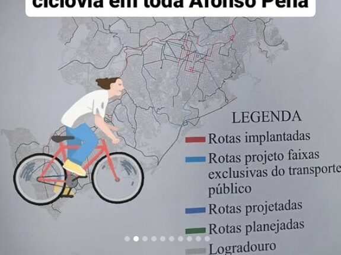

Finalmente, entre 2019 e 2023, o projeto de ciclovia da Afonso Pena é desenhado e estruturado por profissionais especializados e apresentado à sociedade, onde recebe sugestões e críticas, passando por votação e aprovação em diversos conselhos municipais.

**9- A Afonso Pena não é a melhor rota para os ciclistas**

Se a rua A for receber ciclovia, muitos dirão que a rua B é mais adequada, mas se a rua B for a escolhida, outros dirão que a rua A tinha atributos melhores. São os chamados NIMBY's da ciclovia (ciclovia não no meu quintal), onde a pessoa se diz favorável à ciclovia, mas nunca, jamais onde ela está sendo feita. 

Quem primeiro utilizou deste expediente foi o presidente da câmara na última legislatura, o vereador Gabriel Azevedo, o qual [argumentou](https://www.instagram.com/p/C2IuV1XOEBW/?hl=pt-br) que para se chegar na praça da Bandeira no alto da Afonso Pena, o caminho mais utilizado pelos ciclistas era o trajeto pelo córrego do Acaba Mundo, pegando a Bernardo Monteiro, Prof. Moraes, Grão Mogol, Uruguai e Bandeirantes.

Contudo, essa tese ficou fragilizada a partir de [estudo](https://observatoriodabicicleta.org.br/compara-rotas-bh/) que realizei com dados do Strava Metro, onde constatei que a subida pela Afonso Pena era 10 vezes mais usada pelos ciclistas e na descida a preferência pela Afonso Pena era 14 vezes maior do que a rota proposta pelo vereador.

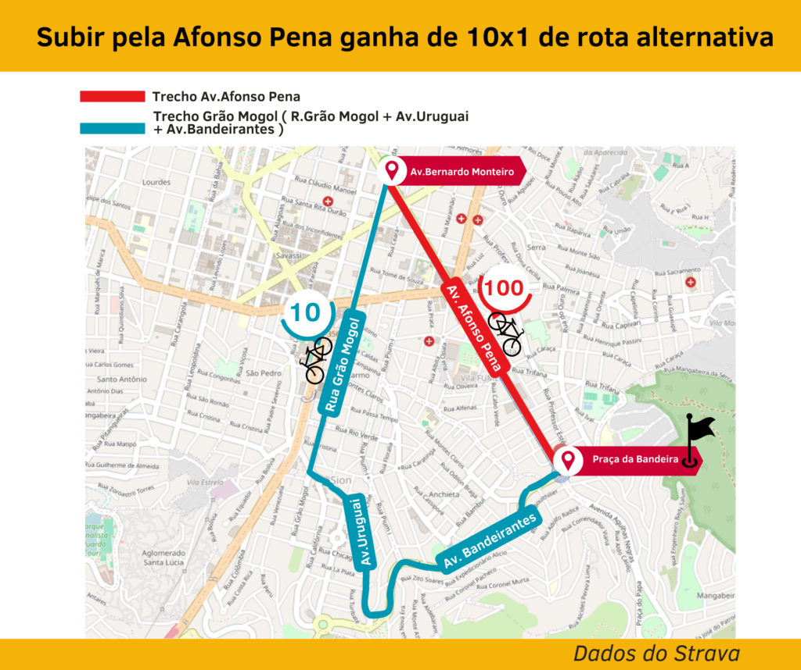

Estudo publicado originalmente no Observabici

Vale lembrar que quando se trata de ciclovia é desejável que exista mais de uma rota cicloviária e por isso o Plano Diretor da cidade prevê rotas cicloviárias tanto na Afonso Pena, como nas ruas sugeridas pelo vereador.

**8- Ciclovia leva nada a lugar nenhum**

Outra mentira muita difundida é que a ciclovia não leva nada a lugar nenhum.

Isso implica em dizer que a praça 7, o centro, o parque municipal, o Palácio das Artes, a Savassi, a praça Milton Campos, Sion, Serra ou a praça do Papa são "lugar nenhum"...

Ademais, neste caso, como justificar a existência das dezenas de faixas feitas para os carros ao longo da avenida?

A verdade é que ciclistas precisam ou querem acessar serviços, residências, comércio e lazer como todos os outros cidadãos. Portanto, se determinada via já existe para os carros e tem demanda de uso, é esperado que também tenha para quem pedala.

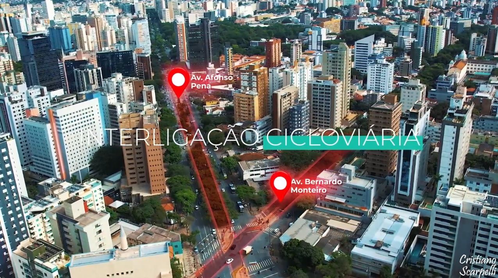

Vídeo: [Projeto de ciclovia da Afonso Pena](https://www.youtube.com/watch?v=r2my5Tj3KPE&list=PLtguQcYT3Wr4HhsLOZAZtx0dkJHUEkf0y&index=2)

Por fim, vale registrar que a ciclovia da Afonso Pena vai permitir a interligação com outras importantes ciclovias, como as da Bernardo Monteiro, Prof. Moraes, Alvares Cabral, João Pinheiro, Santos Dumont e Paraná, as quais, por sua vez, já interligam com outras ciclovias na cidade.

**7- Ciclovia derruba árvores**

No início, uma mentira que sensibilizou muita gente foi dizer que a ciclovia exigiria o corte de diversas árvores ao longo da avenida. Inclusive, essa acusação está presente no pedido do Ministério Público para suspender a obra e de forma surpreendente foi aceito pelo TJMG no recurso de agravo.

Todavia, nunca houve previsão de corte de árvores por conta da ciclovia. Inclusive, em vários trechos, a ciclovia prevê uma ciclovia de traçado sinuoso a fim de evitar o corte de árvores.

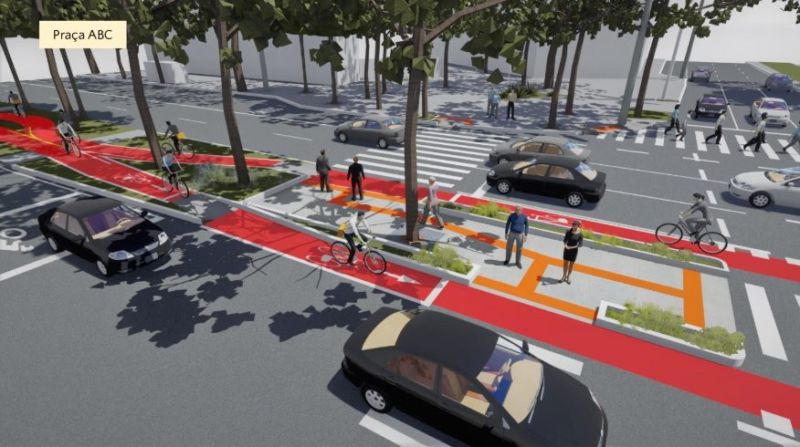

Arte: BHTRANS

Pode ser que essa mentira conseguiu credibilidade, porque as primeiras versões do projeto da Afonso Pena previam cortes de algumas árvores para construção de ilhas de travessia em três cruzamentos na avenida, mas essa era uma demanda relacionada à mobilidade motorizada, sem relação com a ciclovia.

Só que até isso deixou de existir. Em meados de 2023, após discussões nos conselhos municipais, a prefeitura desistiu de construir as ilhas de travessia e com isso, nenhuma árvore mais precisa ser suprimida.

**6- Ciclovia eleitoreira**

Confesso que chamar algo de eleitoreiro não me parece fazer muito sentido, pois, no final das contas, numa democracia, todos os atores políticos buscam votos e qualquer obra, para o bem ou para o mal, terá algum efeito eleitoral.

Mas o conteúdo mentiroso dessa afirmação reside no simples fato que num país como o Brasil, o que se tem de mais eleitoreiro nas campanhas são promessas de mais obras viárias para os motorizados, como novos viadutos, túneis, motofaixas ou panacéias milagrosas, como semáforos inteligentes ou carros autonômos.

Já ciclovia está longe de dar votos. Na verdade, costuma ocorrer o contrário, as críticas às ciclovias é que se tornam eleitoreiras.

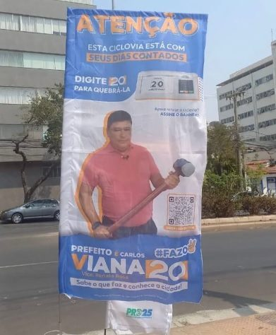

Foto: Reprodução/Redes Sociais

Em Belo Horizonte, foram pelo menos 4 candidatos a prefeito (Gabriel Azevedo, Mauro Tramonte, Bruno Engler e Carlos Viana) que prometeram desfazer a ciclovia da Afonso Pena e usaram suas redes sociais para atacar o projeto. Entre os candidatos a vereador, o número foi ainda maior.

**5- Precisa ser um super-atleta para subir a Afonso Pena**

É compreensível que a mentira de que precisa ser um superatleta para subir a Afonso Pena tenha boa difusão entre quem não pedala ou não pratica atividades físicas de forma regular.

Mas quem pedala sabe bem que subidas não são um obstáculo intransponível. É óbvio que um maior esforço físico é necessário, mas com um pouco de condicionamento físico e uma bicicleta com marcha, a maioria consegue sem maiores problemas.

Tanto é verdade, que a Dona Ana Lúcia, perto de completar seus 78 anos está longe de ser uma super-atleta, mas sobe a Afonso Pena pedalando diversas vezes.

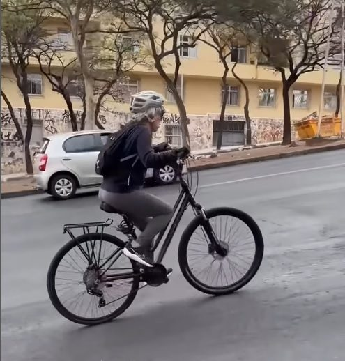

Imagem: Cristiano Scarpelli

Importante notar que <a href="https://www.researchgate.net/publication/260266075_How_Far_Out_of_the_Way_Will_We_Travel_Built_Environment_Influences_on_Route_Selection_for_Bicycle_and_Car_Travel" target="_blank" rel="noreferrer noopener">alguns estudos</a> utilizam 10% de declividade como referência de limite a partir do qual o uso da bicicleta pode ficar exigente.

[Analisando a declividade](https://bhmap.pbh.gov.br/v2/mapa/idebhgeo#zoom=5&lat=7796347.98754&lon=611873.36868&baselayer=base&layers=declividade_vias) dos 4,3 km de extensão da Avenida Afonso Pena, percebe-se que ela ultrapassa os 10% praticamente em um quarteirão, mais exatamente entre as Ruas Maranhão e a Avenida do Contorno. Na verdade, parcelas expressivas do trajeto tem declividade menor do que 5%, o que é bastante confortável para o uso da bicicleta.

Por fim, bicicletas elétricas permitem superar com tranquilidade declividades bem acentuadas, como ficou comprovado por [Gelton Filho](https://www.instagram.com/p/C-7gAjEuALm/?hl=pt) (110 Kg). Em Belo Horizonte também é possível alugar bicicletas elétricas em vários pontos da cidade, as quais disponibilizam o serviço por valores super acessíveis.

**4- Ciclovia custou R\$ 25 milhões**

Insinuar custos estratosféricos é sempre uma forma eficiente de insuflar as pessoas contra uma política pública ainda sem grande aceitabilidade. O procedimento padrão é dizer que a cidade precisa antes resolver problemas de saneamento, educação, moradia ou saúde.

O curioso é que ninguém lembra dessas prioridades quando se gastam bilhões para obras viárias destinadas aos automóveis!

Mas a grande mentira nessa história foi pegar o valor global do projeto, os R\$ 25 milhões, e jogar todo ele na conta da ciclovia. O projeto da Afonso Pena prevê gastos não apenas com a ciclovia mas também com obras de paisagismo, irrigação, pavimentação, recapeamento de toda a pista dos automóveis, construção de faixas exclusivas e preferenciais para os ônibus, obras de acessibilidade para cadeirantes e revitalização de calçadas, de forma que, o gasto com a ciclovia é apenas uma fração desse valor.

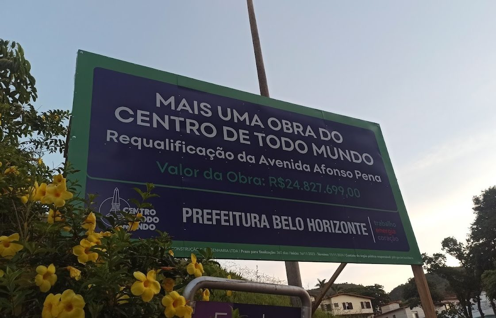

Foto: Cristiano Scarpelli

Por vários motivos é muito difícil estimar o valor da ciclovia separadamente, pois as intervenções foram orçadas conjuntamente. Mas tendo como padrão o custo por Km de ciclovia em outros locais, é possível imaginar que dificilmente a ciclovia custaria mais do que R\$ 4 milhões.

E se vier a custar um pouco mais, o será por conta de uso de piso drenante, de custo mais elevado, o qual foi escolhido para evitar problemas de impermeabilização do solo nos trechos em que a ciclovia está prevista em cima do canteiro central. 

**3- Ciclovia vai deixar os carros sem espaço**

Uma mentira é melhor difundida quando consegue tocar em medos e inseguranças mais profundos das pessoas. Para quem passa raiva todo dia no trânsito, imaginar que uma via congestionada vai ter espaço reduzido para os carros pode levar à sensação de pânico. Portanto, para fazer prosperar o sentimento anti-ciclovia, nada melhor do que vender a ideia de que a ciclovia "rouba" espaço dos carros.

Todavia, este medo carece de fundamento por vários aspectos. O mais importante a se notar é que a ciclovia será em sua maior parte em cima do canteiro central e por isso, ela vai exigir a [retirada de menos de 1,6%](https://www.instagram.com/p/C_seIVROVA_/?hl=pt) do espaço ocupado pelos carros na avenida.

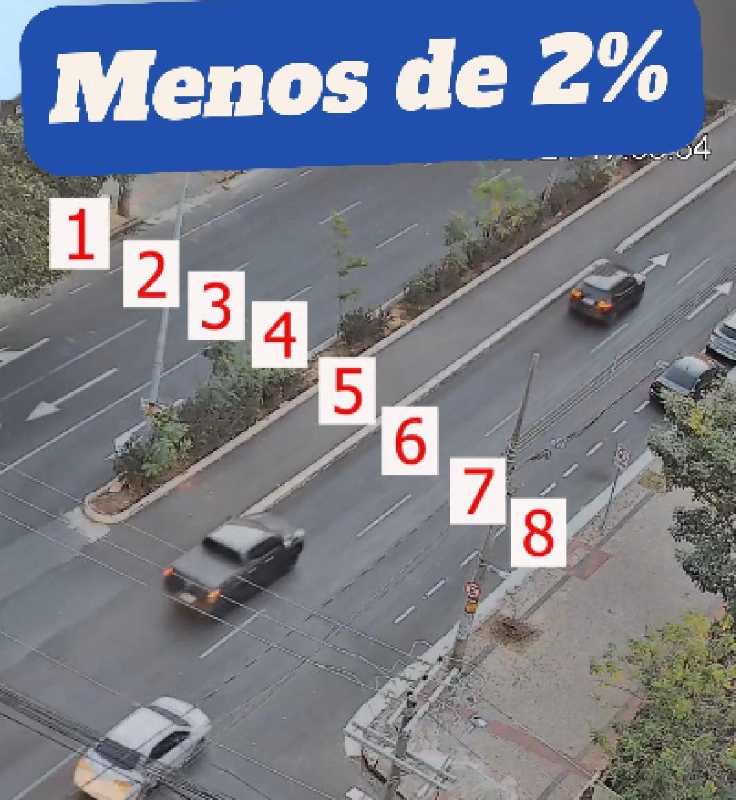

Gravação para contagem de ciclistas na Afonso Pena. Foto: Cristiano Scarpelli

Ademais, diversos estudos e experiências tem apontado que dar novas opções de transporte ou até mesmo suprimir faixas de rolamento pode resultar no fenômeno de evaporação do tráfego, o que traz melhorias para o trânsito e aumento do espaço livre para quem trafega.

**2- Ninguém usa a ciclovia**

Essa mentira ficou em segundo lugar por ter altíssima difusão, aceitabilidade e conter uma trapaça engenhosa.

A trapaça reside no fato de que, via de rega, a oferta de uma infraestrutura de mobilidade antecede sua demanda. Por exemplo, aviões não decolam sem aeroporto, nem carros atravessam rios sem que existam pontes ou balsas.

Essa condição é especialmente forte no caso da bicicleta, pois pedalar no meio dos carros apresenta diversos riscos, inclusive de vida. Portanto, a demanda pelo uso de uma ciclovia ganha verdadeiro impulso depois que ela é construída.

No caso da Afonso Pena, a obra foi interrompida e só fizeram 550m de ciclovia (12% do projetado). Vale notar que este trecho ainda não tem ligação com outras ciclovias e termina no meio da avenida, sem apresentar uma travessia segura.

Ainda assim, mesmo com todas essas limitações, o número registrado de ciclistas na ciclovia e na avenida é bem acima do divulgado pelos críticos. Dentro da ciclovia cheguei a registrar 72 bicicletas passando em dia de semana e 171 no final de semana. Considerando toda a via, <a href="https://www.youtube.com/watch?v=EDyrxTWQl4c" target="_blank" rel="noreferrer noopener">registrei</a> uma média de 131 viagens de bicicleta por dia em um pequeno segmento da parte alta da avenida e 400 em outro segmento na <a href="https://www.youtube.com/watch?v=t6vDLoDDQWw&amp;t=2003s" target="_blank" rel="noreferrer noopener">parte baixa</a>.

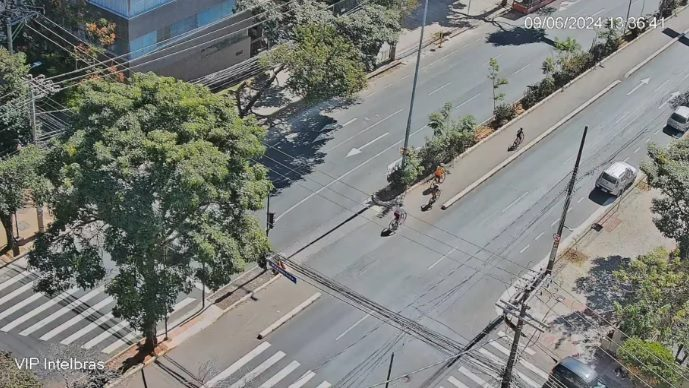

Gravação para contagem de ciclistas na Afonso Pena. Foto: Cristiano Scarpelli

Apesar de não ser possível fazer uma estimativa precisa, se imaginarmos, que metade das viagens ao longo de toda a avenida não passam pelos dois pontos de contagem que utilizei, o total atual de viagens em toda a sua extensão <a href="https://www.instagram.com/p/C7MAhpyO3gt/" target="_blank" rel="noreferrer noopener">poderia chegar a aproximadamente mil</a> . E com base em [outras evidências](/artigo/em-apenas-um-ano-viagens-de-bicicleta-quase-triplicam-na-ciclovia-da-augusto-de-lima/), é possível esperar que esse número venha a triplicar depois que a ciclovia ficar pronta.

**1- Trânsito caótico por culpa da ciclovia**

Por fim, a maior mentira de todas é sem dúvida dizer que a ciclovia atrapalhou o trânsito.

Temos que reconhecer que essa mentira é a mais fácil de difundir, pois tem forte apelo emocional. Intuitivamente, a maioria acredita que o trânsito é sempre caótico em qualquer parte da cidade.

Só que no alto da Afonso Pena, congestionamento é algo raríssimo! Existem poucas residências e comércio na parte alta, de forma que o fluxo de veículos é baixo em qualquer horário.

Isso já foi constatado quando da elaboração do projeto da Afonso Pena. A empresa de engenharia Fratar, contratada pela prefeitura, realizou contagem veicular em vários pontos da avenida no ano de 2019. O gráfico abaixo mostra o fluxo de veículos, por quarteirão, identificado no pico da tarde de 17:00h às 18:00h.

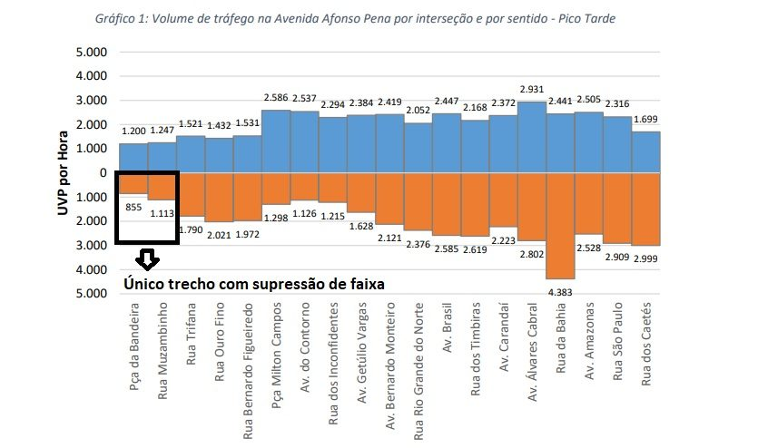

Fonte: Fonte: Relatório Técnico V do Lote 5 feito pela Fratar Engenharia Consultiva em atendimento ao Contrato Nº DJ047 de 2019

O único trecho com supressão de faixa atinge um fluxo máximo de 1.113 veículos por hora em toda a pista no sentido bairro-centro ou 556 veículos/faixa/hora, caso consideremos as duas faixas remanescentes. Conforme o estudo da Fratar, o fluxo de veículos poderia triplicar, que ainda assim as 2 faixas restantes atenderiam a contento a demanda.

Foi por isso que avaliaram não ser preciso suprimir a faixa de estacionamento, a qual, vale destacar, [atende um número menor de pessoas](https://www.instagram.com/reel/DBOODj6udct/?hl=pt) do que o potencial da ciclovia.

Se não bastasse, durante todo o ano de 2024, usei câmeras de segurança para registrar de forma ininterrupta o trânsito no local. Foram mais de 130 horas de vídeos gravados do alto de um apartamento com visão abrangente da avenida.

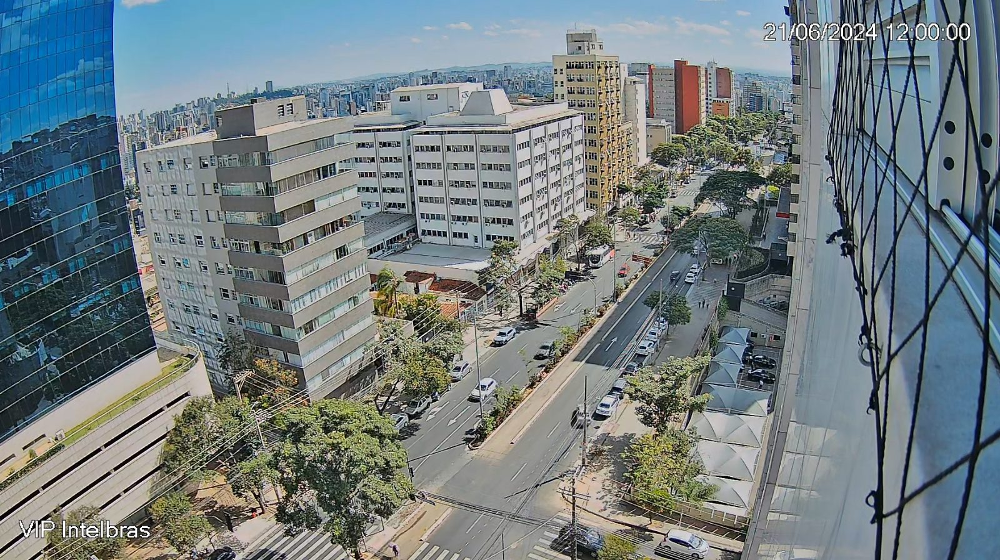

Imagem: Cristiano Scarpelli

Parte desse material foi publicado nas <a href="https://www.youtube.com/watch?v=0GpqzWiEuHk&amp;t=7977s" target="_blank" rel="noreferrer noopener">redes sociais</a> e disponibilizado para a Justiça, através de uma ação de *Amicus Curiae*.

**Terminou?**

Listei apenas as 10 mentiras mais difundidas e que tiveram algum efeito na opinião pública.

Mas existem muitas outras e provavelmente daria para listar mais uma dezena.

A verdade é que essa geração de Fake News é sustentada inteiramente pela predisposição das pessoas em buscar algum tipo de defesa contra algo que julgam ameaçar o seu modo de vida e, infelizmente, contra isso não há fatos que convençam do contrário.
