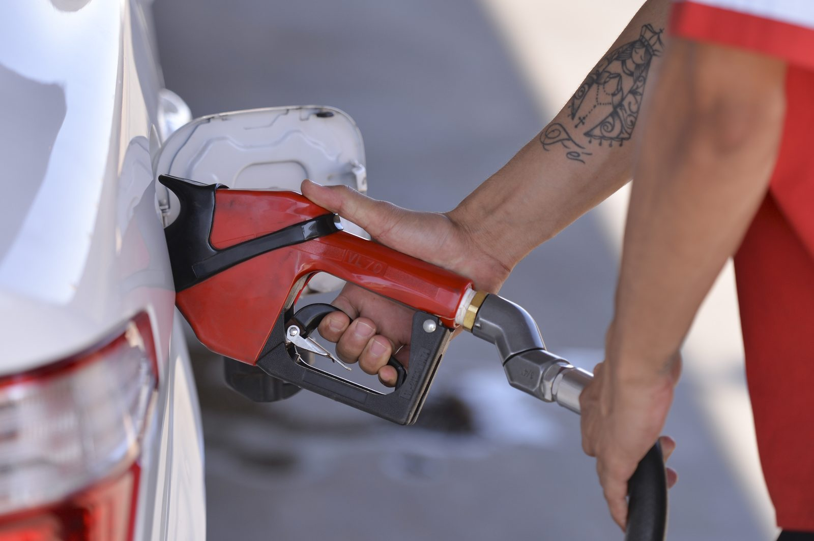
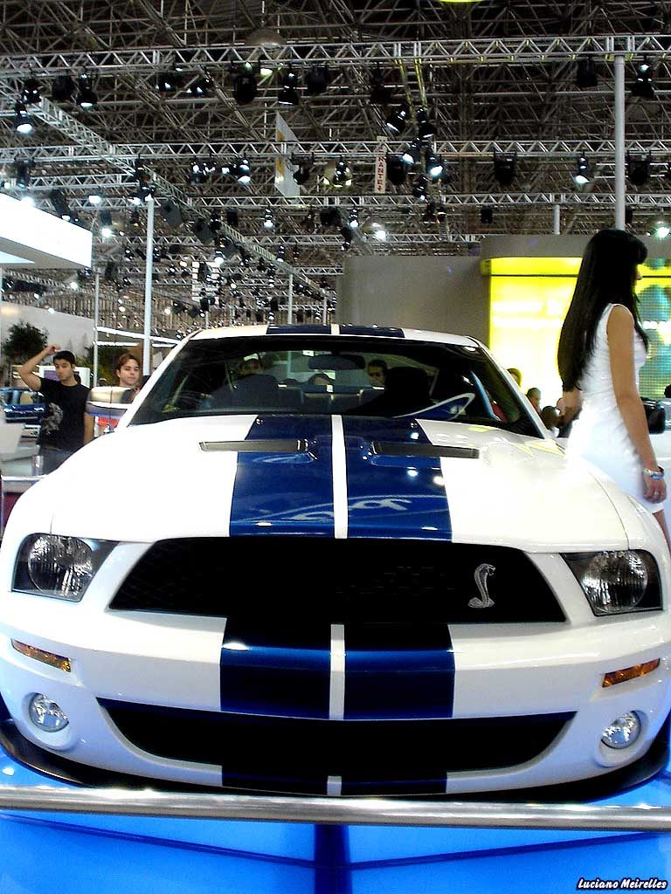
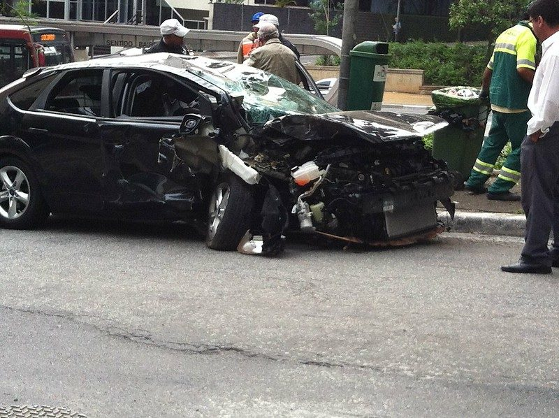

A coisa mais curiosa da cultura sobre rodas brasileira é que tudo — absolutamente tudo — que se relacione aos carros pode virar notícia! Do mais banal ao trágico.

Às vezes, assistindo ao jornal, fico imaginando como seria se não houvesse nenhuma reportagem sobre automóveis. O jornal não duraria nem cinco minutos! Sem notícias sobre engarrafamentos, sem o frentista pendurado na janela tentando alcançar o motorista que fugiu sem pagar, sem as batidas no anel rodoviário, sem os motoqueiros esmigalhados, sem os projetos de pedágios ou sem o senador que arrumou um trator para acabar com um deles. Como seria?

Como seria sem as histórias de crianças esquecidas e mortas nos bancos de trás por adultos distraídos? Sem as tais prestações intermináveis ou os casos de manobristas que batem carros de luxo — que, francamente, pouco me importa a marca? Quem me dera virar notícia por deixar qualquer coisa cara quebrar no serviço! Como seria viver sem ouvir sobre a alta dos combustíveis, os buracos nas ruas, as avós atropeladas ao ajudar seus netos ou aquele sujeito arrogante que bateu o carro pela quinta vez, embriagado, nas madrugadas da cidade?

"[Fotos produzidas pelo Senado - Posto de combustível](https://www.flickr.com/photos/49143546@N06/52295579365)" by [Senado Federal](https://www.flickr.com/photos/49143546@N06) is licensed under [CC BY 2.0](https://creativecommons.org/licenses/by/2.0/?ref=openverse).

Fico pensando: como seria um jornal sem as notícias do IPVA e o tal número final da placa relacionado com uma data para pagamento? Ou sem as matérias sobre o cálculo do seguro? Como ficaríamos sem as imagens de assaltantes arrombando veículos, levando bolsas, celulares e causando medo — muito medo? É de se espantar!

Como seria viver sem o motorista reclamando da ciclovia e do congestionamento que, curiosamente, <a href="https://caosplanejado.com/licoes-da-ciclovia-da-afonso-pena-em-belo-horizonte/" data-type="link" data-id="https://caosplanejado.com/licoes-da-ciclovia-da-afonso-pena-em-belo-horizonte/">nunca existiram no tal local</a>? Ou sem ouvir sobre os atrasos nas grandes avenidas — essas sim, que nunca viram, nem verão, qualquer espaço para ciclistas? Melhor nos distrairmos um pouco, rirmos, com a notícia sobre o tal influencer — que ninguém de fato conhecia — comprando um carro roxo de bolinhas ou estilizando um veículo caríssimo com tema de um desenho infantil. E o carro do jogador de futebol? Qual será? Que curioso!

"[Ford Mustang GT500 - Salão do Automóvel](https://www.flickr.com/photos/96053152@N00/318279493)" by [Luciano Meirelles](https://www.flickr.com/photos/96053152@N00) is licensed under [CC BY-SA 2.0](https://creativecommons.org/licenses/by-sa/2.0/?ref=openverse).

E o galho da árvore? Quando se fala de carros, o meio ambiente também tem seu espaço! No caso, aquela árvore que caiu na tempestade, amassando a lataria de alguém. Como se lataria fosse coisa viva — mais viva que a própria árvore! Essas árvores nem perdem tempo antes de "pularem" na frente de algum veículo em movimento. Melhor seria cortarmos tudo logo: duplicássemos as vias, tapássemos os rios, asfaltássemos tudo! Se bem que não. Onde estacionaria meu carro na sombra? E as notícias sobre ruas alagadas e motoristas presos, transformando carros em pequenas ilhas? Não gostaria de ficar órfão delas.

De fato, seria muito estranho passar o dia sem assistir à cobertura de um acidente na estrada que matou uma família inteira ou daquela outra que sobreviveu por um milagre. Seria ótimo se esquecêssemos das 80 mortes diárias no trânsito brasileiro— gente jovem, saudável e com muito futuro — daqueles para quem nem milagre nem oração antes da partida adiantaram de alguma coisa. Deus é quem sabe das coisas.

Foto Milton Jung no <a href="https://www.flickr.com/photos/22155587@N02/8285983988" data-type="link" data-id="https://www.flickr.com/photos/22155587@N02/8285983988">Flicker</a>

Como seria ligar no jornal sem ouvir que a poluição está alarmante, das ilhas de calor, que o estresse só aumenta e que novos pardais serão instalados? Essa indústria da multa é a culpada de todos os males!

Sempre me pego pensando nessas coisas. Como seria o noticiário sem os carros — e sem notícias sobre eles? Sem o carro esquisito da empresa do bilionário, sem o carro autônomo, sem o carro elétrico, sem o carro voador, sem o carro movido a água, sem o carro movido a gás, sem o carro que, independentemente do combustível, do meio, da tecnologia ou do condutor, insiste em trafegar mais lento que as carroças do século XIX com a sua inteligência equina? Sem o carro que sempre precisa de mais espaço, de uma nova ponte, de um novo viaduto; que exige que se tire ou coloque um sinal, que se tape um buraco, que se reforme a via que ele mesmo destruiu?

O que, afinal, o jornalista iria noticiar sem se ter carros?

Seria um completo caos.
