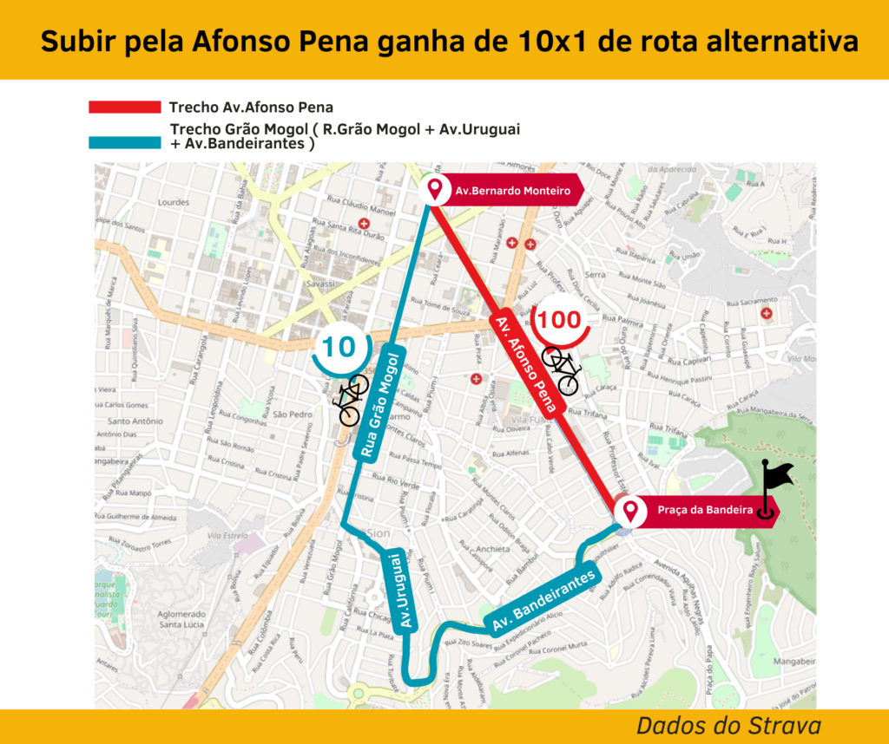
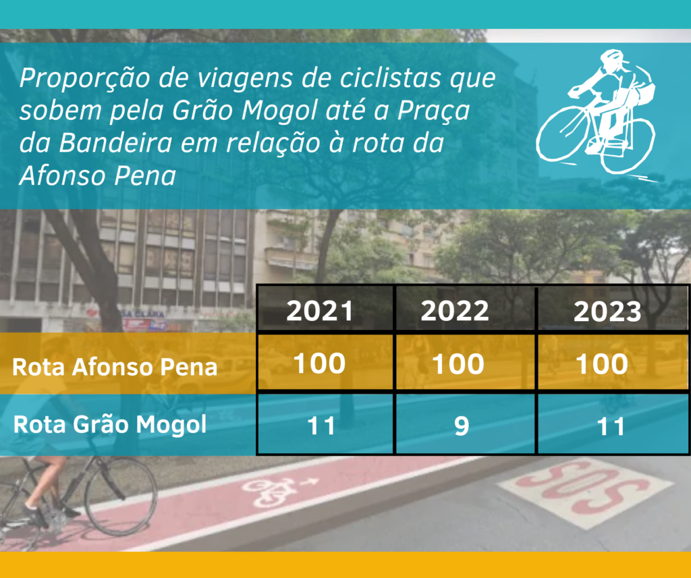
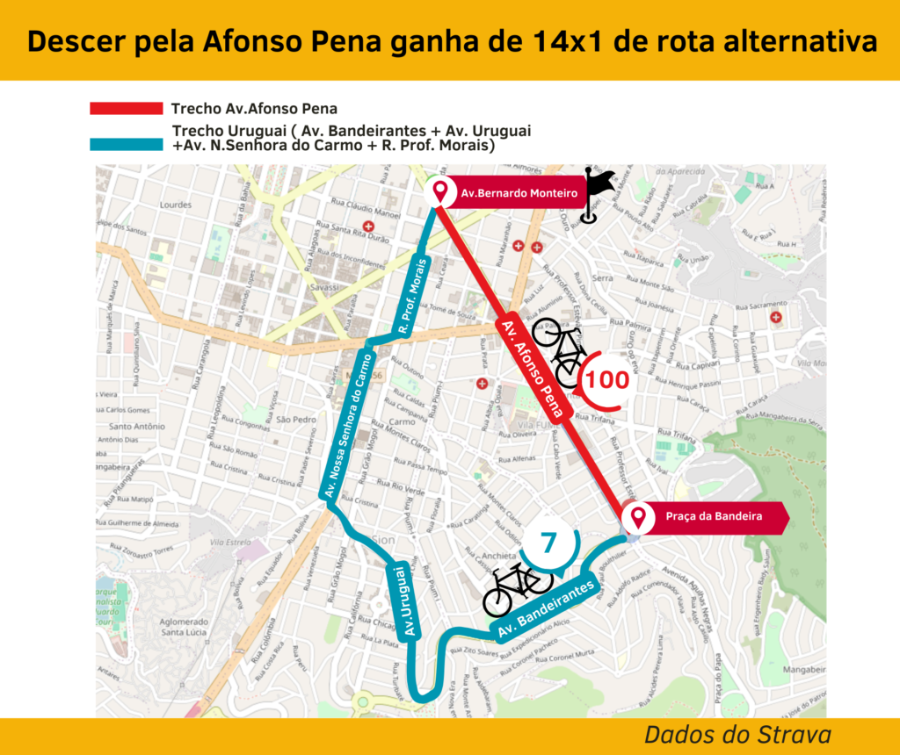
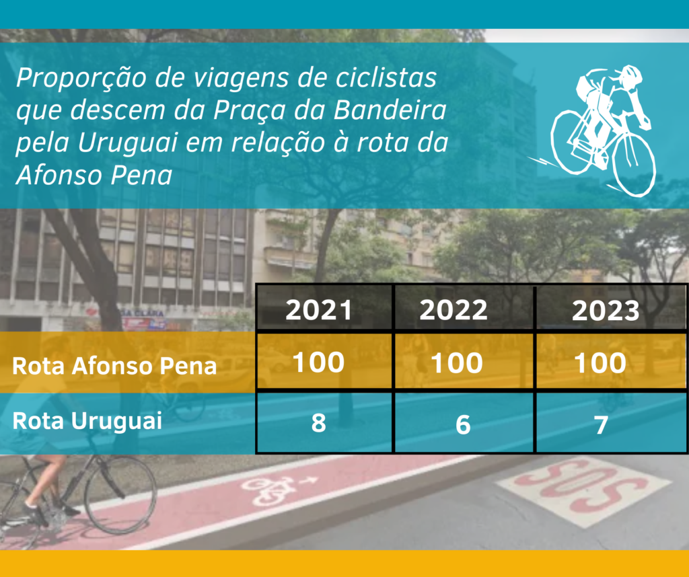

**Por Cristiano Scarpelli**

A prefeitura de Belo Horizonte está construindo uma ciclovia na Avenida Afonso Pena, que é uma das vias mais importantes de Belo Horizonte. Todavia, o vereador Gabriel Azevedo propôs que para se chegar na Praça da Bandeira, seria melhor construir uma ciclovia nas Avenidas Grão Mogol, Uruguai e Bandeirantes.

É importante ressaltar que quando se trata de ciclovia é desejável que exista mais de uma rota cicloviária e por isso o Plano Diretor da cidade prevê rotas cicloviárias em ambos os trajetos em discussão.

De toda forma, a fim de verificar qual rota tem maior potencial para atender aos ciclistas, utilizamos os dados do Strava Metro para verificar qual trajeto foi mais utilizado pelos usuários do aplicativo nos últimos anos.

Assim, comparamos a rota que está recebendo ciclovia com aquela proposta pelo vereador. Analisamos os anos de 2021, 2022 e 2023, verificando-se segmentos que sobem e descem entre a Bernardo Monteiro e a Praça da Bandeira. A tabela e o mapa a seguir fazem a comparação dos caminhos que sobem até a praça da Bandeira.

Fica fácil perceber que em todos os anos analisados, a rota mais utilizada foi sempre seguir em linha reta pela Afonso Pena. Pelos números é possível constatar que para cada 100 pedaladas subindo pela Afonso Pena, tem-se somente 10 viagens de bicicleta que seguem o caminho proposto pelo vereador Gabriel Azevedo. Portanto, a rota do presidente da Câmara é dez vezes menos utilizada do que aquela que está recebendo ciclovia.

Vamos agora ao resultado de quem desce da praça da Bandeira até a Bernardo Monteiro.

No caso das descidas, a diferença em favor da rota da Afonso Pena é ainda maior É possível dizer que para cada 100 ciclistas que descem da Praça da Bandeira até a Bernardo Monteiro, somente 7 ciclistas seguem o caminho proposto por Gabriel Azevedo (o vereador não especificou como seria a volta, então foram analisados somente segmentos da Bandeirantes, Uruguai e Bernardo Monteiro). Isso quer dizer que o caminho pela Afonso Pena é 14 vezes mais utilizado do que aquele proposto pelo vereador.

**Detalhamento das rotas e dos segmentos:**

- Rota Afonso Pena = quantidade de viagens em vários segmentos subindo desde a Bernardo Monteiro até a praça da Bandeira.
- Rota Afonso Pena 2 = quantidade de viagens em vários segmentos descendo desde a praça da Bandeira até a Bernardo Monteiro.
- Rota Grão Mogol = quantidade de viagens em vários segmentos desde a Bernardo Monteiro, passando pela Grão Mogol e chegando na praça da Bandeira
- Rota Uruguai = quantidade de viagens em vários segmentos desde a praça da Bandeira, passando pela Uruguai e chegando na Bernardo Monteiro.

Observação: O número de segmentos marcados em cada rota variou de 09 a 10. Importante ressaltar que os resultados podem variar de acordo com os segmentos marcados, mas nos testes realizados, não houve alterações relevantes.

\* Publicado originalmente no [Observatório da bicicleta](https://observatoriodabicicleta.org.br/compara-rotas-bh/), em janeiro de 2024
