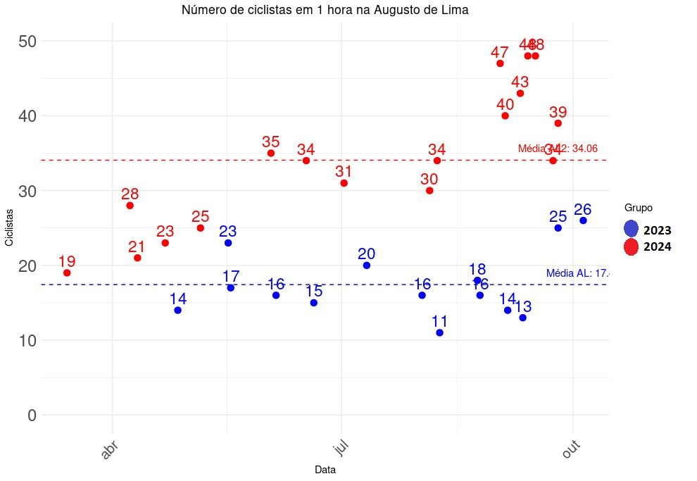
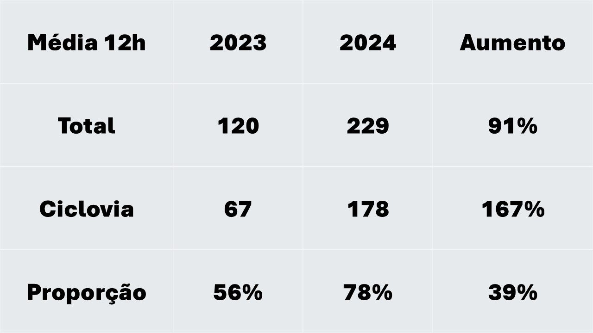
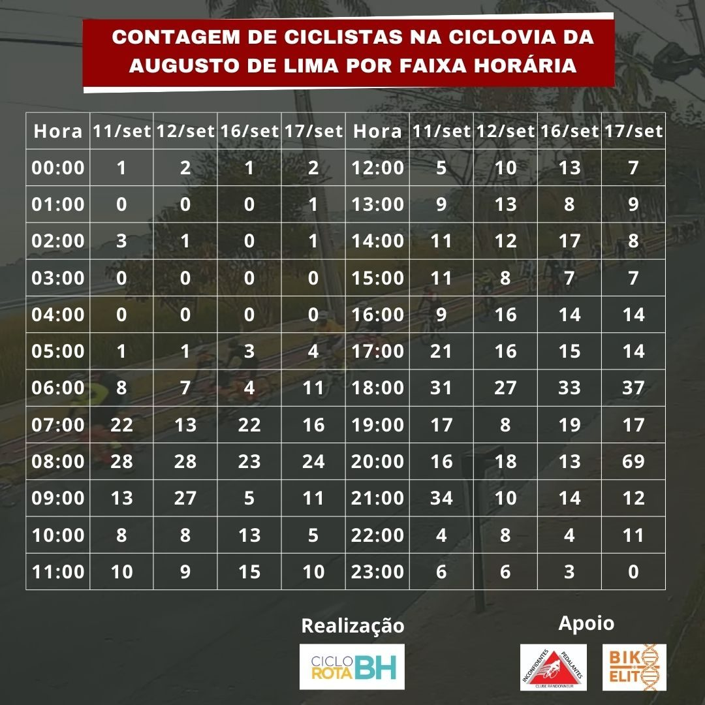

Este ano, Belo Horizonte ganhou o primeiro estudo de impacto que uma ciclovia tem no fluxo de ciclistas.

Em 27 de abril de 2023, pouco antes de começarem as obras de implementação de uma ciclovia de apenas 2 km na avenida Augusto de Lima, decidi começar a registrar o número de ciclistas que passavam na avenida.

As contagens foram realizadas na altura do número 1075, em frente à Pizzaria do Porto, em dias úteis, não chuvosos, de segunda a quinta, entre às 18h e 19h e de forma presencial. Ao final do mês de Setembro de 2024, completamos 31 aferições, 14 delas realizadas ao longo de 2023 e 17 no ano de 2024<a href="#98e3dc0d-11fa-46d3-9716-9541f836461c" id="98e3dc0d-11fa-46d3-9716-9541f836461c-link">1</a>.

A ideia inicial era averiguar somente o impacto da ciclovia no fluxo de ciclistas. Todavia, no final de setembro de 2023, BH recebeu várias estações de bicicletas compartilhadas e algumas delas foram instaladas ao longo da avenida e arredores.

Como a ciclovia foi concluída mais ou menos no mesmo período, tornou-se impossível analisar os efeitos da ciclovia isoladamente. Portanto, o presente estudo aponta o impacto das duas intervenções (ciclovia + bicicletas compartilhadas)

Ademais, a literatura sobre o tema sugere que estudos de impacto de ciclovias sejam feitos pelo menos 6 meses depois da intervenção. Por isso, optei por realizar as comparações entre os anos de 2023 e 2024, já que as contagens de ciclistas de 2024 começaram em meados de março, o que praticamente coincide com os 6 meses de prazo.

Assim, o gráfico abaixo compara os dados colhidos nos dois períodos:

Interessante observar o progressivo crescimento no fluxo de ciclistas. No ano de 2023, antes da conclusão da ciclovia e da chegada das bicicletas compartilhadas, a média ficou em 16 e raramente passou de 20. Já no início do ano seguinte, quase todas as observações ficam acima de 20 e a média sobe para 23. Entre junho e agosto, todas as observações ficam acima de 30 e a média se aproxima de 33. Por fim, as aferições realizadas no mês de setembro apresentam valores quase sempre acima de 40 e a média chega perto de 43.

Uma comparação ano a ano mostra que a média quase dobrou em 2024. Quando comparamos somente os dados de setembro de 2024 com setembro de 2023, observamos que o fluxo de ciclistas quase triplicou

O segundo estudo realizado na avenida foi feito através de câmeras de segurança instaladas em uma residência na avenida, próxima ao número 1674, as quais permitiram aferir o número de bicicletas pelo período de 24h. Dessa forma, em 2023 consegui contar o número de bicicletas que passaram dentro e fora da ciclovia durante 3 dias inteiros. Já em 2024, contei bicicletas dentro e fora da ciclovia por 3 dias, somente dentro da ciclovia por 4 dias e pelo período de 1h realizei 5 registros.

Interessante observar que os registros de 1h são muito similares às 31 contagens realizadas presencialmente em frente à Pizzaria do Porto. A média de setembro em frente à pizzaria foi de 42,7 e a média das 5 contagens realizadas alguns quarteirões à frente foi de 40.

Por sua vez, as câmeras de segurança permitem trabalhar com análises mais abrangentes e por um dia inteiro. Todavia, achei melhor trabalhar com o período de 12h (07h às 19h), pois, quando tentei considerar o período de 24h, percebi que as análises poderiam ficar enviesadas, devido à maior presença de grupos de ciclistas noturnos após as 20h. Esses grupos não passam frequentemente no mesmo local e sua quantidade varia bastante, de forma que essa variabilidade tende a enviesar as amostras.

Portanto, a tabela abaixo compara o número de ciclistas que passaram dentro e fora da ciclovia no período de 12h em 2023 e 2024.

Essa tabela traz 3 informações muito importantes.

Primeiramente, podemos observar que o número de deslocamentos de bicleta ao longo da avenida quase dobrou em apenas um ano, passando de uma média de 120 para 229 (período de 12h).

Em segundo lugar, o número de ciclistas que passaram dentro da ciclovia teve um crescimento ainda mais expressivo, passando de apenas 67 para 178, o que representa um crescimento de 167%, ou, em outras palavras, um aumento de quase 2,7 vezes.

Por fim, a última linha retrata a proporção dos ciclistas que passaram dentro da ciclovia em relação ao total. Enquanto em 2023, a proporção ficou em 56%, no ano seguinte deu um salto para quase 80%. Isso sugere que algumas pessoas que não usavam a ciclovia quando de sua implementação passaram a fazê-lo com mais regularidade no ano seguinte.

Para quem quiser realizar outras análises, os dados consolidados estão disponíveis na aba Ciclo Dados deste site. Abaixo também disponibilizo os registros realizados hora a hora dentro da ciclovia no ano de 2024.

