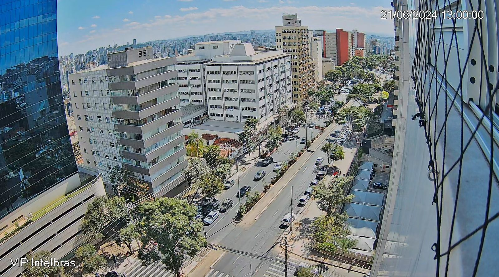
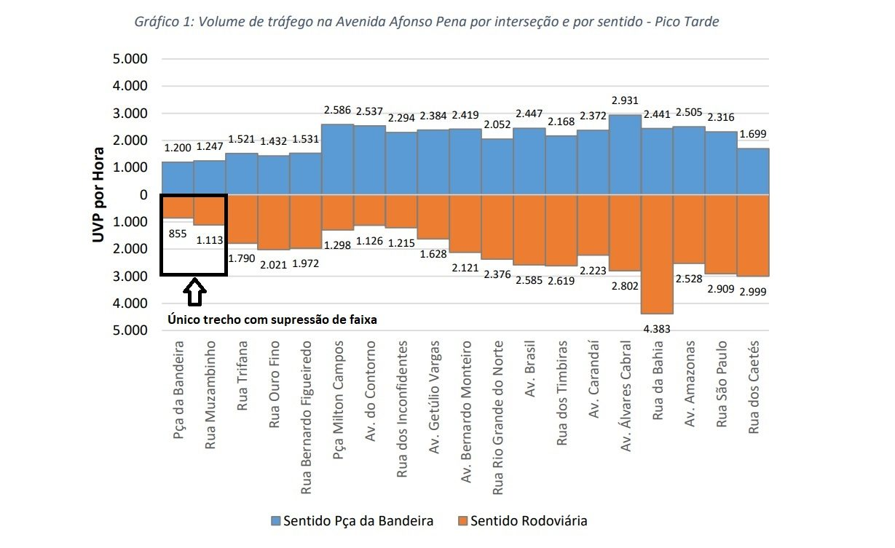
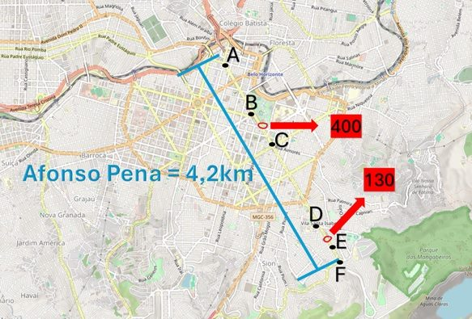
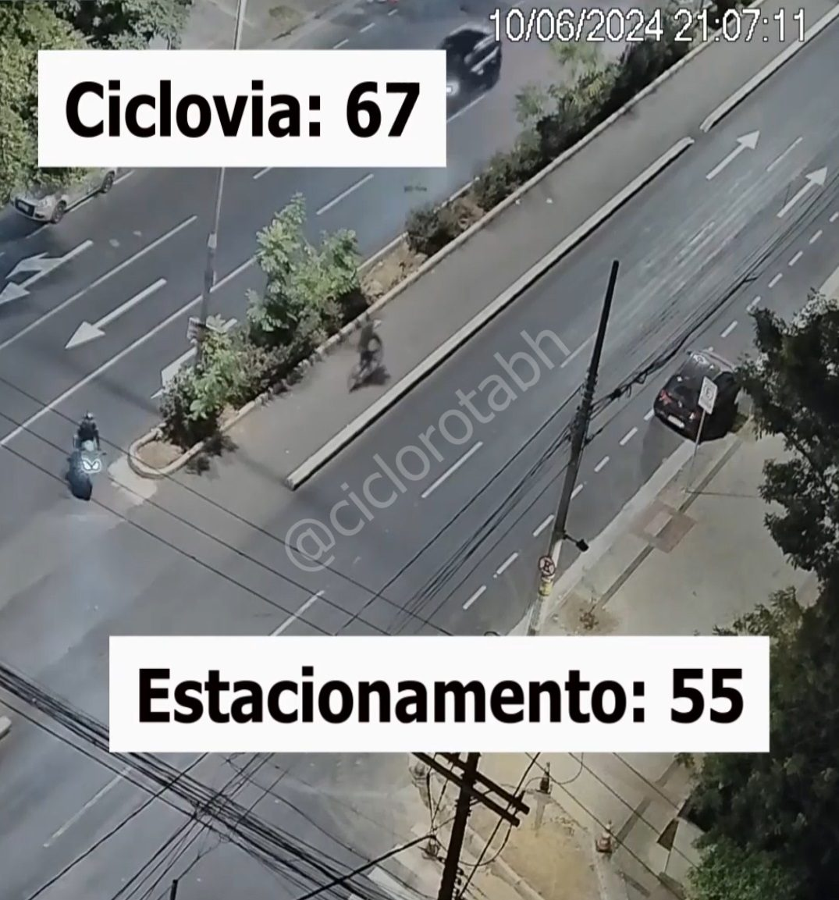

Anteriormente, escrevi [um texto](https://caosplanejado.com/a-ciclovia-da-afonso-pena-em-bh-e-os-argumentos-de-sempre/) rebatendo os principais argumentos contrários à ciclovia da Afonso Pena, os quais costumam se repetir em qualquer cidade com políticas de mobilidade centradas nos automóveis.

De lá para cá, pouca coisa mudou. Devido à forte oposição de diferentes setores da sociedade, [a obra foi suspensa temporariamente pela Justiça](https://www.em.com.br/gerais/2024/06/6874472-justica-determina-paralisacao-das-obras-da-ciclovia-na-afonso-pena-em-bh.html). Se a decisão final do tribunal for favorável à ciclovia, resta ainda saber se o próximo prefeito irá se comprometer a dar continuidade ao projeto.

Nesse período, a obra da ciclovia chegou a ser executada por 500 metros dos 4,2 km previstos. Esse pequeno trecho de ciclovia compromete menos de 2% do espaço atualmente destinado aos automóveis e é o único trecho com previsão de supressão de faixa de rolamento para os automóveis, pois, no resto da avenida, a ciclovia será em cima do canteiro central.

O interessante é que, mesmo com apenas 12% de extensão da ciclovia concluída, já temos alguns valorosos ensinamentos.

**A ciclovia impactou negativamente o trânsito?**

Sem dúvida, a fonte mais poderosa de resistência às ciclovias reside no medo de que essas estruturas possam retirar espaço dos carros e atrapalhar o trânsito.

Na discussão da ciclovia da Afonso Pena esse sentimento também esteve presente, mas estudos realizados antes e depois do começo da obra comprovam que uma vez mais esse tipo de preocupação não tinha fundamento.

Entre fevereiro e agosto de 2024, em diferentes dias, usei câmeras de segurança para registrar de forma ininterrupta o trânsito no local. Foram mais de 130 horas de vídeos gravados do alto de um apartamento com visão abrangente da avenida.

Imagem: Cristiano Scarpelli

Parte desse material foi publicado nas [redes sociais](https://www.youtube.com/watch?v=0GpqzWiEuHk&t=7977s) e recentemente entramos com uma ação de *Amicus Curiae* disponibilizando todo o material para o tribunal que aprecia a questão.

Importante destacar que esses resultados corroboram estudos anteriores feito pela empresa Fratar de engenharia consultiva, a pedido da prefeitura. No ano de 2019, a empresa realizou contagem de veículos em vários pontos da avenida. O gráfico abaixo mostra o fluxo de veículos, por quarteirão, identificado no pico da tarde de 17:00h às 18:00h.

Fonte: Relatório Técnico V do Lote 5 feito pela Fratar Engenharia Consultiva em atendimento ao Contrato Nº DJ047 de 2019

O único trecho com supressão de faixa é, de longe, o com menor fluxo de veículos em toda a avenida. Ele atinge um fluxo máximo de 1.113 veículos por hora em toda a pista no sentido bairro-centro ou 556 veículos/faixa/hora, caso consideremos as duas faixas remanescentes.

Conforme o estudo da Fratar, para uma via arterial (que é o caso da Afonso Pena), o fluxo de saturação por faixa é perto de 1.800 autos/h e a capacidade de passagem nos semáforos nesse trecho é acima de 2.000 autos/h. Isso significa que o fluxo de veículos poderia triplicar, que ainda assim as 2 faixas restantes atenderiam a contento a demanda.

**Indução da demanda**

Geralmente, a oferta de uma infraestrutura de mobilidade antecede sua demanda. Por exemplo, aviões não decolam sem aeroporto, nem carros atravessam rios sem que existam pontes ou balsas.

Portanto, a demanda pelo uso de uma ciclovia ganha impulso depois que ela é construída. Antes disso, a demanda é apenas potencial e aqueles que pedalam no meio da rua o fazem por estarem mais adaptados às adversidades das vias ou simplesmente porque não têm escolha.

Dito isso, é possível estimarmos a demanda potencial de usuários de uma ciclovia?

No caso da Afonso Pena, isso foi possível. As mesmas câmeras de segurança que provaram a inexistência de trânsito caótico por culpa da ciclovia também serviram para aferir o número de ciclistas em algumas avenidas da cidade e chegar nessa estimativa.

[Registrei](https://www.youtube.com/watch?v=EDyrxTWQl4c) uma média de 131 viagens de bicicleta por dia em um pequeno segmento da parte alta da avenida e 400 em outro segmento na [parte baixa](https://www.youtube.com/watch?v=t6vDLoDDQWw&t=2003s), os quais estão destacados de vermelho na imagem abaixo:

Apesar de não ser possível fazer uma estimativa precisa, se imaginarmos, por exemplo, que metade das viagens ao longo de toda a avenida não passam pelos pontos de contagem, o total atual de viagens em toda a sua extensão poderia chegar a aproximadamente [mil](https://www.instagram.com/p/C7MAhpyO3gt/).

Obviamente, caso a ciclovia venha a ser feita, é esperado que a demanda pelo uso da bicicleta aumente. Para o caso de Belo Horizonte, podemos usar como referencial desse possível aumento, números aferidos antes, durante e depois da construção da nova ciclovia na avenida Augusto de Lima, localizada no bairro Barro Preto, próximo da Afonso Pena.

Os [resultados](/artigo/em-apenas-um-ano-viagens-de-bicicleta-quase-triplicam-na-ciclovia-da-augusto-de-lima/) indicam que um ano após a conclusão dessa ciclovia (e da chegada das bicicletas compartilhadas), o número de viagens de bicicleta quase triplicou.

Portanto, na hipótese de que esse fenômeno se repita na Afonso Pena, o número de viagens de bicicleta poderia chegar a 3 mil. Vale lembrar que a Afonso Pena é mais extensa, central e liga um maior número de bairros, o que indica que esse número poderia ser ainda maior.

Esses primeiros apontamentos referem-se apenas ao impacto do primeiro ano da ciclovia e não levam em conta o efeito sistêmico de uma rede cicloviária maior e com mais pontos de interligação, os quais poderiam impulsionar ainda mais o uso da bicicleta em Belo Horizonte ou em qualquer cidade que venha a receber esse tipo de infraestrutura.

**Ciclovia x Estacionamentos**

As filmagens que realizei na Afonso Pena também ajudam a demonstrar que os estacionamentos em vias públicas são uma forma ineficiente de ocupar o espaço urbano (principalmente quando não se cobra preço de mercado pelo espaço).

Em termos de locomoção, uma vaga de estacionamento não beneficia ninguém, pois ela impede a passagem de qualquer pessoa ou veículo. Além disso, todo carro que vai estacionar tende a [reter o trânsito na faixa contígua](https://www.instagram.com/p/C7gvJ4su592/), especialmente quando é preciso realizar uma baliza.

Se não bastasse, [pesquisas relacionadas por Donald Shoup](https://parkade.com/post/donald-shoup-the-high-cost-of-free-parking-summarized) indicam que 30% dos veículos que circulam em locais em que não se cobra um preço de mercado pelas vagas estão circulando à procura do “almoço grátis” da vaga pública, colaborando para saturar o trânsito de forma desnecessária.

Deve-se ressaltar que a vaga de estacionamento é apenas uma comodidade ofertada aos donos de veículos, um subsídio do Estado para uma parcela da sociedade ter o privilégio de usar o escasso espaço público em detrimento de outros usos.

Os estacionamentos também costumam perder no quesito de pessoas beneficiadas. Geralmente, a rotatividade dos estacionamentos em via pública é baixa, especialmente quando não existe cobrança, ou quando ela é de baixo valor ou a fiscalização e as multas não são efetivas.

As imagens que registrei na Afonso Pena também ajudam a comprovar esse último ponto. Na segunda-feira, dia 10 de junho de 2024, das 07h até meia noite, [comparei](https://www.instagram.com/p/C-U5YcmOjDZ/) o número de ciclistas que passaram na ciclovia com o número de carros que estacionaram no lado direito da pista. O resultado foram 71 viagens de bicicleta contra 56 carros que estacionaram no local ao longo do dia.

Observei ainda que a rotatividade de carros estacionados é baixa e a média de tempo que os veículos ficam estacionados tende a ser próxima do limite estabelecido pelo Faixa Azul.

A partir dessas informações, estimei que o número de carros estacionados ao longo do dia no pequeno trecho com ciclovia dificilmente passava de 200, o que já é menor do que o número de viagens registradas em apenas um ponto na avenida e 15 vezes menor do que as 3 mil viagens de bicicletas estimadas um ano depois que a ciclovia estiver pronta.

**Conclusão**

Toda vez que cidades centradas nos automóveis tentam oferecer novas opções de mobilidade, importantes parcelas da sociedade se mobilizam para tentar impedir.  Foi o que ocorreu no caso da ciclovia da Afonso Pena, onde transformaram 500m de ciclovia em campo de batalha, sob a acusação de que ela atrapalharia o trânsito e atenderia número pequeno de pessoas.

Entretanto, registros em vídeo comprovam que estes argumentos não se sustentam. A ciclovia da Afonso Pena compromete menos de 2% do espaço destinado aos automóveis, e mais de 130h de vídeo comprovam que o trânsito continua fluindo normalmente no local.

Apesar de extremamente contraintuitivo, ciclovias tendem a melhorar o trânsito, pois contribuem para o fenômeno da [evaporação do tráfego](https://www.archdaily.com.br/br/959596/evaporacao-do-trafego-o-que-acontece-quando-o-espaco-viario-e-redistribuido) e permitem que algumas pessoas optem pela mobilidade ativa, [induzindo a demanda](https://vadebike.org/2014/08/por-que-apoiar-ciclovias/) por bicicleta/patinetes/monociclos, o que ajuda a retirar carros da rua.

Na Afonso Pena é possível que isso já esteja ocorrendo, pois, com somente 12% da obra concluída, já se observa um fluxo razoável de ciclistas na ciclovia e um número ainda mais expressivo no restante da avenida.

Estimativas apontam que, se a ciclovia fosse finalizada, poderia beneficiar até 3 mil ciclistas apenas no primeiro ano, número 10 ou 15 vezes maior do que o de veículos estacionados ao longo do dia no único trecho em que a ciclovia suprime uma faixa. Estes números reforçam a perspectiva, já bem aceita entre especialistas, de que toda ciclovia tem potencial de atender muito mais gente do que os automóveis, especialmente quando estacionados. E com um objetivo muito mais nobre: preservar vidas humanas, oferecer conforto, segurança, sustentabilidade e um ambiente urbano mais agradável.

\*[Artigo com pequenas alterações](https://caosplanejado.com/licoes-da-ciclovia-da-afonso-pena-em-belo-horizonte/) publicado também no site Caos Planejado
