**MANDADO DE SEGURANÇA COM PEDIDO LIMINAR / DIREITO  
ADQUIRIDO COLETIVO (art. 1º, § 3º da Lei nº 12.016/09)**

Em face do MUNICÍPIO DE BELO HORIZONTE, pessoa inscrita no CNPJ sob o nº 18.715.383/0001-40, com endereço Av. Afonso Pena, nº 1212, bairro Centro, cidade de Belo Horizonte/MG, CEP 30130-003, e tendo como autoridades coatoras Deusuite Matos Pereira de Assis, Presidente da Empresa de Transportes e Trânsito de Belo Horizonte S/A(BHTRANS), com sede na avenida Engenheiro Carlos Goulart, 900, bairro Buritis, Belo Horizonte - MG, CEP 30455-902 e Maurício Fonseca Brandão, Superintendente da Superintendência de Desenvolvimento da Capital (SUDECAP), com sede na Rua dos Guajajaras, 1107, Centro/Lourdes, Belo Horizonte - MG, CEP 30180-105, em razão da omissão administrativa consubstanciada na falta de sinalização viária no logradouro avenida Afonso Pena, pelos fundamentos fáticos e jurídicos adiante delineados.

**I – FATOS**  
Contra ato omissivo ilegal e abusivo praticado pelas autoridades coatoras indicadas, consubstanciado na falta de iniciativas para implantação e manutenção da sinalização horizontal e vertical nos trechos já concluídos da ciclovia localizada na avenida Afonso Pena, o que expõe os ciclistas a risco iminente de acidentes e viola o direito líquido e certo do Impetrante à locomoção segura, pelos fatos e fundamentos a seguir expostos.

**A) HISTÓRICO DA OBRA**  
**2006** - A ciclovia da Afonso Pena vem sendo pensada e planejada desde 2006, quando se iniciaram os primeiros estudos para estruturar uma rede cicloviária para Belo Horizonte.  
**03/09/2013** - o Decreto Municipal Nº 15.317 instituiu o Plano Diretor de Mobilidade Urbana de Belo Horizonte - PlanMob-BH - e estabeleceu as diretrizes para o acompanhamento e o monitoramento de sua implementação, avaliação e revisão periódica.  
**2014** - Implementação do PlanMob-BH por meio de debate com a sociedade, na IV Conferência de Política Urbana. A primeira diretriz do PlanMob estabelece: “I- A priorização dos pedestres e dos modos de transporte não motorizados sobre os motorizados e dos serviços de transporte público coletivo sobre o transporte individual motorizado”  
**2015 e 2016** - O PlanMob foi revisto com base nas contribuições coletadas na IV Conferência Municipal de Política Urbana e na participação da sociedade civil organizada por meio do Observatório da Mobilidade.  
**08/08/2019** - O PlanMob-BH foi incorporado à Lei Nº 11.181, que aprova o Plano Diretor do Município de Belo Horizonte. O Anexo IX do Plano Diretor de Belo Horizonte define a rede cicloviária, onde destaca-se a Av. Afonso Pena, em toda a sua extensão, como um eixo cicloviário do Programa Pedala BH.  
**2019** - PBH contrata estudos técnicos e projetos executivos de prioridade ao transporte coletivo, incluindo a Avenida Afonso Pena.  
**Abril e Maio de 2022** - Reuniões com o Sindicato das Empresas de Transporte de Passageiros de Belo Horizonte - Setra-BH.  
**Maio de 2022** - Consulta pública.  
**Junho e Julho de 2022** - Realizadas reuniões com o GT Pedala.  
**Julho e Agosto de 2022** - Reuniões com a Câmara de Dirigentes Lojistas de Belo Horizonte CDL-BH.  
**Agosto de 2022** - Audiência Pública da Comissão de Desenvolvimento Econômico, Transporte e Sistema Viário da Câmara Municipal de Belo Horizonte.  
**Abril de 2023** - Finalização do projeto.  
**24/05/2023** - Aprovação do projeto no Conselho Municipal do Patrimônio.  
**Setembro de 2023** - Apresentado ao Conselho Municipal de Mobilidade Urbana – Comurb.  
**06/09/2023** - Estudo de contagem veicular que subsidiou o projeto de requalificação da Afonso Pena feito pela empresa Fratar Engenharia Consultiva EPP através do contrato 01202333020015 e custou aos cofres públicos a importância de R\$ 303.400,00.  
**12/09/2023** - Publicado o edital para as obras.  
**18/10/2023** - Assinatura do contrato para serviços de requalificação da mobilidade na Afonso Pena com a empresa RFJ CONSTRUTORA (publicação do extrato do contrato no DOM dia 20/10/23).  
**13/11/2023** - Início das obras na Afonso Pena  
**01/04/2024** - Petição do MPMG através da Ação Civil Pública 5077901-10.2024.8.13.0024, exigindo a suspensão das obras da ciclovia até que seja feito o licenciamento urbanístico.  
**16/04/2024** - Negada a liminar para a paralisação das obras.  
**15/05/2024** - Agravo de instrumento do MPMG para que a decisão da liminar seja revista;  
**20/06/2024** - Agravo de instrumento aceito em liminar e obras voltam a ficar suspensas. Assim, as obras físicas relativas à ciclovia foram concluídas até perto do final do quarteirão do TJMG entre as ruas Muzambinho e Trifana, faltando neste trecho apenas providenciar as devidas sinalizações horizontais (pictogramas) e verticais (placas R-34, A-30B e semáforos para ciclistas).  
**28/02/2025** - Provimento definitivo ao recurso do Agravo de instrumento e por isso as obras  
continuam suspensas.  
**28/04/2025** - PARECER JURÍDICO DPCT-SD n° 066/2025 ,o qual justifica aditivo ao contrato 01202327000182 por que “passou a ser indispensável a revisão do projeto para implantar o paisagismo no trecho onde seria a ciclovia a fim de não deixar a obra com aspecto de inacabada”.  
**30/05/2025** – Pedido de Cristiano Scarpelli e Juliane Rocha ao COMPUR para que seja providenciado o licenciamento urbanístico a fim de que a Ação Civil Pública (ACP) perca o objeto e a Prefeitura possa retomar as obras (Ticket 31.00426196/2025-55) .  
**12/06/2025** - [Audiência Pública na Câmara Municipal](https://www.youtube.com/watch?v=kRXHWII-_iE&t=8995s) sobre a ciclovia da Afonso Pena em que diversos servidores da Prefeitura afirmaram estarem prontos para dar continuidade ao projeto.**04/11/2025** - Fim do prazo de execução física do contrato  
**24/11/2025** - Solicitação para que implementem as sinalizações horizontais e verticais onde a ciclovia já está pronta. Frente ao pedido de sinalização vertical não tivemos resposta e para o pedido de sinalização horizontal alegaram que a sinalização no trecho contratado seria responsabilidade da SUDECAP (Tickets 31.00910856/2025-20 e 3100910877/2025-35).  
**26/11/2025** - Ofício SUDECAP/EXT nº312/2025, no qual a Sudecap justifica que não pediu a suspensão do contrato para “manter o contrato ativo, permitindo que os serviços não afetados seguissem em execução regular”.  
**29/11/2025** - Questionamento através da LAI 31.00929163/2025-23 do por que a Prefeitura não providenciou a sinalização vertical e horizontal dos trechos já concluídos da ciclovia.  
**06/01/2026** - Ofício SUDECAP/CTGM nº 018/2026 em resposta aos questionamentos de sinalização horizontal e vertical, no qual a Sudecap afirma que “aguardará o trânsito em julgado da sentença da Ação Civil Pública nº 5077901-10.2024.8.13.0024 para avançar em qualquer decisão/atuação no assunto”.  
**09/01/2026** - Em resposta à demanda de sinalização horizontal, a BHTRANS informa que o projeto de faixa exclusiva, em que estava prevista a implantação da ciclovia na Av. Afonso Pena, foi contratado e implantado sob responsabilidade da SUDECAP  
(Protocolo:31.00910856/2025-20).  
**19/01/2026** - Ofício BHTRANS DSV - SUTRANSP nº 001/2026, em que o Diretor de Sistema Viário da BHTRANS afirma que as faixas de ônibus do projeto da Afonso Pena precisam ter complementação de sinalização, as quais serão feitas depois do Carnaval, ou seja, após o término do prazo contratual que foi usado como justificativa para negar a implementação da sinalização para a ciclovia (Ticket LAI 31.00961527.3/2025-88).  
**04/03/2026** - Em resposta à demanda de sinalização vertical, a BHTRANS informa que o projeto de faixa exclusiva, em que estava prevista a implantação da ciclovia na Av. Afonso Pena, foi contratado e implantado sob responsabilidade da SUDECAP. (Protocolo 31.00910877/2025-35)  
  
**B) Pedido do Ministério Público na ACP**  
A Ação Civil Pública 5077901-10.2024.8.13.0024 ajuizada pelo Ministério Público do Estado de Minas Gerais - MPMG requerendo a paralisação de implantação da ciclovia da Afonso Pena não está a proibir a execução da ciclovia de forma permanente (até porque a ciclovia da Afonso Pena está prevista no anexo IX da Lei 11.181/19) e sim condicionando sua continuidade, até que o Conselho Municipal de Política Urbana (COMPUR) faça o licenciamento urbanístico que eles entendem ser previstos em Lei.  
  
Nesse sentido, entendemos que existem apenas dois caminhos possíveis para o cumprimento da Lei 11.181/19. Ou as obras da ciclovia são retomadas sem o exigido licenciamento urbanístico ou as obras são retomadas em um prazo mais dilatado, após a feitura do licenciamento urbanístico.  
  
Portanto, inexiste justificativa para que a Prefeitura não prossiga com as obras e principalmente **deixe de viabilizar a devida sinalização nos trechos** já concluídos, pois para que a Lei 11.181/19 seja cumprida, a ciclovia precisa ser feita.  
  
**C) Omissão do poder público**  
Desde o aceite da liminar do agravo de instrumento em 20/06/2024 e especialmente após a sua confirmação em 28/02/2025, o poder executivo poderia ter providenciado diversas alternativas para garantir a execução do contrato 01202327000182, mas nada fez.  
  
Uma primeira alternativa era realizar o licenciamento urbanístico exigido pelo Ministério Público a fim de que a Ação Cível Pública perdesse o objeto e com isso as obras pudessem ser retomadas.  
  
Inclusive, em 30/05/2025, através do Ticket (Ticket 31.00426196/2025-55) solicitou-se oficialmente que a PBH analisasse essa alternativa, mas o pedido está sem resposta até hoje.  
  
Em 25/06/2025 foi a vez da conselheira Edwiges Leal solicitar na 329º reunião do COMPUR que fosse realizado o licenciamento urbanístico a fim de não depender de decisão judicial, mas também nunca deram retorno.  
  
Uma segunda alternativa para cumprir com o previsto no Plano Diretor, seria a Prefeitura solicitar a prorrogação do contrato, o que é previsto no art. 115 § 5º da Lei de Licitação, mas o poder executivo seguiu o caminho inverso.  
  
Em 11/07/2025, a Prefeitura pediu uma breve prorrogação do contrato (Aditivo DJ - 075/23), não para garantir a implantação da ciclovia, mas sim para implementar obras que desvirtuavam o objeto principal do contrato, prevendo “implantar paisagismo no trecho onde seria executada a ciclovia (Ofício GSTIE-SD/GAB-SMOBI nº312/2025).  
  
Finalmente, desde a decisão proferida pelo juiz Danilo Couto Lobato Bicalho em 15 de setembro de 2025, autorizando a retomada das obras da ciclovia, foram várias as solicitações para que garantisse o cumprimento do contrato e para que as sinalizações nos trechos já concluídos fossem instaladas, mas novamente a Prefeitura ficou inerte.  
  
Em 14 de Outubro de 2025, em [audiência pública na Câmara Municipal](https://www.cmbh.mg.gov.br/comunica%C3%A7%C3%A3o/not%C3%ADcias/2025/10/mobilidade-urbana-deve-consumir-quase-r-2-bi-dos-recursos-municipais-em), o vereador Wagner Ferreira (PV) questionou a PBH sobre a possível retomada das obras da ciclovia. Na ocasião, o representante da Prefeitura afirmou que iriam aguardar o trânsito em julgado do processo.  
  
Em 19/11/2025, através do Ticket 31.00903637/2025-60 indagou-se à Prefeitura por que ainda não tinham retomado as obras da ciclovia e se haviam tomado alguma medida para garantir o cumprimento futuro do contrato.  
  
Através do ofício SUDECAP/EXT nº312/2025 a resposta foi que “a Prefeitura iniciou uma análise técnica e administrativa aprofundada para reavaliar o cronograma e a compatibilização do projeto da ciclovia com outras intervenções e estudos de mobilidade urbana em andamento na região central (…)”.  
  
Em 22/11/2025, 24/11/2025 e 29/11/2025, através dos tickets 31.00908248/2025-14, 31.00910877/2025-35, 31.00910856/2025-20 e 31.00929232/2025-23, indagou-se por que ainda não haviam implementado as sinalizações horizontal e vertical previstas nos trechos em que as obras cicloviárias já estavam concluídas e solicitamos que o fizessem.  
  
Desde então, as justificativas apresentadas pela Prefeitura para não prosseguir com nenhum tipo de intervenção foi que era preciso “a adoção de postura administrativa cautelosa diante de cenário jurídico ainda pendente de estabilização definitiva, bem como a inexistência de contrato vigente apto a amparar a retomada das intervenções”. (Resposta Ofício SUDECAP/ SUTRANSP nº 036/2026 Ref.: Manifestação nº.: 31.00060729/2026-4)  
  
**D) Inconsistências das negativas apresentadas pelo Município**  
Em 12/07/2025, através do protocolo 31.00546156/2025-62, indagamos à prefeitura por que não esperavam o trânsito em julgado da Ação Civil Pública 5077901-10.2024.8.13.0024 para proceder à revisão do projeto que fizeram através do aditivo DJ 075/23, o qual previa implantar paisagismo nos locais onde a ciclovia estava prevista.

Em 29/07/2025, a SUDECAP afirmou que “os ajustes visam adequar o andamento da obra às restrições judiciais atualmente impostas, assegurando que a cidade não permaneça com uma intervenção inacabada por período indefinido”.  
  
Todavia, neste mesmo aditivo DJ 075/23 a Prefeitura não se preocupou em estender o prazo de execução física do contrato para além de 04/11/2025, a fim de garantir a implantação futura da ciclovia, o que faria verdadeira diferença para que a via não ficasse com aspecto de inacabada.  
  
E ainda pior, dentro do prazo contratual, a prefeitura poderia ter retomado as obras desde a sentença do juiz Danilo Bicalho do dia 15/09/2025, mas novamente, não se preocupou em estender o prazo contratual e se absteve até mesmo de implementar as sinalizações horizontais e verticais nos trechos já concluídos da ciclovia, que mais do que qualquer outra intervenção, ajudariam a não deixar a intervenção com aspecto de inacabada.  
  
Por sua vez, enquanto no ofício SUDECAP/EXT nº312/2025, o superintendente Leonardo José Gomes Neto afirmou que “após a decisão proferida nos autos da Ação Civil Pública nº 5077901-10.2024.8.13.0024, que afastou o impedimento legal da execução da ciclovia, a Prefeitura iniciou uma análise técnica e administrativa aprofundada (…)”, no ofício SUDECAP/SUTRANSP nº038/2026 feito com o objetivo de complementar as informações do ofício precedente, os Superintendentes Leonardo José Gomes Neto e Daniel Garcia Toscano afirmaram que as “análises técnicas e administrativas aprofundadas, utilizadas no referido ofício, refere-se a discussões internas de natureza técnica e administrativa (…), que surgiram em decorrência da suspensão da execução da ciclovia no âmbito da Ação Civil Pública nº 5077901-10.2024.8.13.0024”.  
  
Ou seja, as justificativas apresentadas são contraditórias e incompatíveis em termos temporais, pois enquanto a primeira afirma que iniciaram estudos aprofundados após a decisão de 15 de Setembro do juiz Danilo Couto Bicalho, a segunda afirma que esses estudos foram realizados bem antes desta decisão, mais precisamente, no ano anterior quando da suspensão da execução da ciclovia.  
  
Importante notar que apenas 03 meses antes da citada decisão judicial favorável à retomada das obras e 05 meses antes do fim do prazo contratual, em [audiência pública realizada na Câmara Municipal](https://www.youtube.com/watch?v=kRXHWII-_iE&t=8995s) em 12/06/2025, ocorreram uma série de falas esclarecendo que o corpo técnico da Prefeitura estava pronto para a retomada das obras:

- O supervisor de projetos e obras especiais na BHTRANS, Mauro Luiz Cardoso de Oliveira afirmou que “a medida que o processo andar juridicamente nós estamos prontos para dar continuidade à implantação.

<!-- -->

- Liliana Hermont, diretora de Planejamento Estratégico e Inovação da Superintendência de Mobilidade (Sumob) afirmou que “se houver algum comando autorizando a retomada das obras, possivelmente isso que vai acontecer.”

<!-- -->

- Daniel Garcia Toscano Barreto, Diretor de Infraestrutura - DINF da SUDECAP afirmou que “acabando essa discussão judicial/política estamos prontos para continuar esse projeto (…)”  

Ademais, a justificativa de **fim do prazo contratual**, apresentado recentemente pela SUDECAP em resposta ao Tickets 31.00929163/2025-43, para negar a implementação das sinalizações horizontais e verticais na ciclovia, **carece de fundamentação**, pois conforme ofício BHTRANS DSV – SUTRANSP nº 001 / 2026, a BHTrans confirma que os serviços de sinalização da faixa de ônibus constantes no mesmo contrato ainda não foram finalizados, pois “Há necessidade de complementação da sinalização horizontal, dizeres e símbolos e posicionamento das placas em braços projetados, **o que será feito somente após o Carnaval**, devido a necessidade de passagem de trios elétricos”. (Resposta da BHTrans ao item do 2 do questionamento do Ticket LAI 31.00961527.3/2025-88.  
  
Por fim, a própria SUDECAP esclarece no ofício SUDECAP/ SUTRANSP nº 036/2026 que “**destaca-se que a definição, implantação e operação da sinalização viária integram as competências institucionais da BHTRANS**, cabendo à SUDECAP a gestão e fiscalização dos contratos de obras sob sua responsabilidade, nos limites do respectivo escopo contratual”  
  
**E) Precedente de implementação de sinalização cicloviária após prazo contratual**  
  
Em diversas outras obras cicloviárias em ruas da capital, tal qual na ciclovia da Afonso Pena, houve descontinuidade na implementação da obra e instalação de sinalização horizontal e vertical muito após o fim do contrato.  
  
Um exemplo ilustrativo é o da ciclovia na Via-710, onde as sinalizações horizontais e verticais da ciclovia no local ocorreram anos depois do encerramento contratual e vários trechos continuam sem sinalização até hoje.

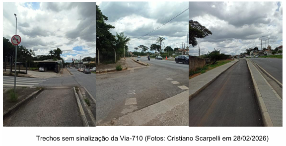

Em 28/11/2017, Mateus Proença requereu ao CRTT da regional Leste que pintassem a interseção da Rua Minduri com a Via-710 e a travessia em frente à estação José Cândido da Silveira.

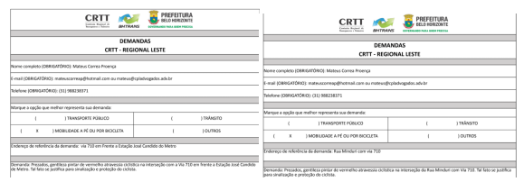

Mas 7 anos depois ainda não tinha sido feito:

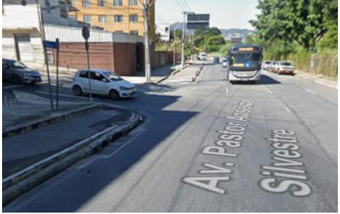

O primeiro trecho a ser pintado foi apenas em 2021, mas apenas alguns poucos metros indo da estação Minas Shopping até perto do viaduto:

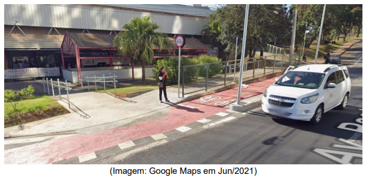

Na verdade, boa parte das sinalizações foram implementadas pela BHTrans somente no final de 2024, após demanda deste requerente nos autos de PP 0024.23.014099-8 realizado junto à 16.ª Promotoria de Justiça de Habitação e Urbanismo de Belo Horizonte. No ponto 11 do Parecer Técnico da BHTRANS/DSV/GECIP N° 015/2024 (OFÍCIO GAB-PGMEXTER 1487 2024) de 19 de março de 2024, a BHTrans confirmou que pretendia complementar a sinalização faltante:

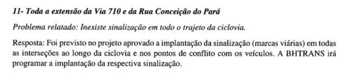

**F) Pareceres técnicos**  
Para que não reste dúvida da necessidade técnica e legal de viabilizar as sinalizações horizontais e verticais nos trechos em que a ciclovia já foi concluída, convém trazer à baila pareceres de profissionais e especialistas em mobilidade urbana. Vejamos:  
  
1) “Independentemente da interrupção do projeto completo, é de extrema urgência a correta sinalização do trecho da ciclovia que já foi construído ao público entre a Praça da Bandeira e o quarteirão do TJMG entre as ruas Muzambinho e Trifana. A justificativa apresentada pela Prefeitura no ofício SUDECAP/SUSTRANSP 036/2026, de que a ciclovia geraria “conflitos com a sinalização existenteˮ não se sustenta, pois a obra da ciclovia já se encontra finalizada no trecho citado e é a falta de sinalização que potencializa a geração de conflitos”.  
***Felipe Alberto Martins Alves**: Engenheiro Civil, especialista em Mobilidade Urbana e em Segurança Viária Coordenador do Grupo de Trabalho de Infraestrutura na União de Ciclistas do Brasil - UCB Representante da UCB na Câmara Temática de Engenharia de Tráfego e Sinalização de Trânsito - CTET do Conselho Nacional de Trânsito - CONTRAN.*

2\) “Algumas ações do poder público são prejudiciais a todos cidadãos e às contas públicas, sejam elas municipal, estadual ou federal. Uma delas é a não conclusão e complementação de uma obra, ficando os trabalhos sem qualquer finalização. Seja  
ela uma ponte – chamada de obra de arte –; um reparo de um grande buraco numa via; seja outro tipo de infraestrutura urbana ou rural”.  
***Antonio Carlos de Mattos Miranda: Urbanista, MSc. em Tecnologia e Sociedade pela UTFPR, ex-funcionário do GEIPOT, autor de 3 manuais de planejamento cicloviário brasileiro.***  
  
3) “A infraestrutura cicloviária foi parcialmente executada, porém não foi devidamente sinalizada, como previsto no Código de Trânsito Brasileiro – artigo 88, que afirma: “Nenhuma via pavimentada poderá ser entregue após sua construção, ou reaberta ao trânsito após a realização de obras ou de manutenção, enquanto não estiver devidamente sinalizada, vertical e horizontalmente, de forma a garantir as condições adequadas de segurança na circulação.”, e que apresenta como complemento o “Parágrafo único. Na vias ou trechos de vias em obras deverá ser afixada sinalização específica e adequada”. A falta de sinalização viária é um fator de risco e exposição principalmente aos mais vulneráveis. No caso da infraestrutura cicloviária, a sinalização é um fator que amplia a segurança de ciclistas que circulam na avenida”.  
***Suzana Leite Nogueira: Arquiteta e urbanista***  
  
4) “(…) o referido trecho foi liberado ao tráfego sem a conclusão da sinalização horizontal e vertical, encontrando-se está incompleta ou insuficiente para garantir a segurança dos usuários da via, especialmente ciclistas, pedestres e condutores de  
veículos automotores”.  
***João Paulo Simões Nascimento: Arquiteto e Urbanista – CAU-MG 19735*5**  
  
**G) Prejuízo ao erário**  
Em resposta ao ticket LAI 31.00990031.2/2025-78, o Ofício SUDECAP/ SUTRANSP nº 036/2026 explica que as obras não foram retomadas pois “a matéria permanece pendente de trânsito em julgado, motivo pelo qual, conforme orientação da Procuradoria-Geral do Município, a Administração Municipal adota postura de cautela administrativa, resguardando a segurança jurídica, o interesse público e o erário”.  
  
Cabe salientar que a não retomada das obras ou ainda pior, o eventual desfazimento do que já foi executado é que representaria verdadeiro prejuízo ao erário, além de afronta à Lei 11.181/19.  
  
Conforme ofício GS TIE-SD/GAB-SMOBI nº 312/2025 de 05 de junho de 2025, o valor medido referente aos serviços para implantação da ciclovia, até o momento presente de sua paralisação, foi de R\$ 314.938,41.  
  
Ademais, um dos estudos que subsidiaram o projeto de requalificação da Afonso Pena foi feito pela empresa Fratar Engenharia Consultiva EPP através do contrato 01202333020015 e custou aos cofres públicos a importância de R\$ 303.400,00.  
  
Ou seja, somente estas duas rubricas já somam mais de R\$ 600.000,00 gastos com a ciclovia e não estamos contabilizando os gastos administrativos, com pessoal e de tempo na formulação e discussão do projeto ao longo de mais de 20 anos.  
  
Devemos reforçar esse ponto, pois seria bastante temerário que uma nova gestão pudesse arbitrariamente descontinuar ou desfazer obras previstas em Lei.  
  
Portanto, é fundamental entendermos que as obras já concluídas da ciclovia constituem valoroso e consolidado patrimônio público que precisam ser disponibilizadas aos cidadãos com a devida sinalização.  
  
**H) Necessidades do requerente**  
O Impetrante utiliza diariamente a bicicleta como meio de transporte para se deslocar pela cidade, especialmente no trajeto que compreende a ciclovia da Afonso Pena.  
  
Também utiliza uma bicicleta Tandem (com 2 assentos) para pedalar com seu irmão incapaz e do qual é curador. Para esse tipo de bicicleta e por conta das incapacidades do seu irmão, uma infraestrutura cicloviária é imprescindível.

Além disso, sua mãe, Dona Ana Lucia Aguiar Pacheco, uma senhora de 78 anos também precisa de mais segurança para pedalar na avenida e até organizou um [abaixo-assinado](https://www.change.org/p/apoio-%C3%A0-constru%C3%A7%C3%A3o-da-ciclovia-na-afonso-pena) com mais de 2.400 assinaturas em apoio à ciclovia.  

Importante ainda aduzir, que a ciclovia é utilizada por cadeirantes que encontram no local um fácil acesso para se locomover, sem riscos dos passeios mal cuidados, assim como também das ruas onde dividem o espaço com veículos.

A ciclovia também é um lugar seguro para os pais trafegarem com crianças, conforme verificado nas imagens abaixo. Sabido, que a ciclovia já terminada no alto da Afonso Pena é rota para se chegar no Mangabeiras, ou acessar Av. Bandeirantes.

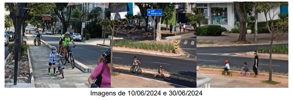

Conforme se verifica pelas fotografias anexas, não implementaram nenhuma das sinalizações previstas no projeto. Não há pictogramas (símbolos de bicicleta) que indiquem a destinação exclusiva da via, não há placas de regulamentação (como a R-34 – "Circulação exclusiva de bicicleta") nos acessos, tampouco placas de advertência (A-30B – "Passagem sinalizada de ciclistas") nos cruzamentos com vias transversais para alertar os motoristas.  
  
**1- Praça da Bandeira**

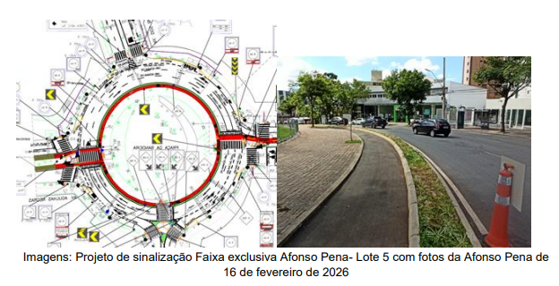

**2- Saída da Praça da Bandeira**

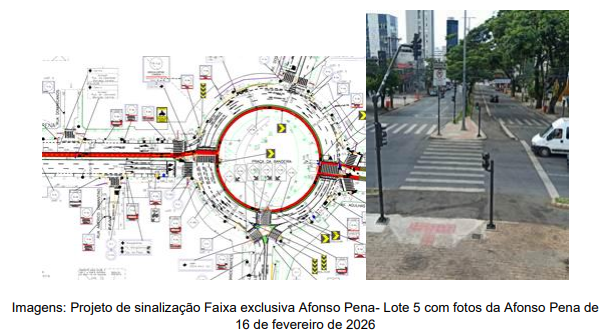

**3- Esquina Dominicanos**

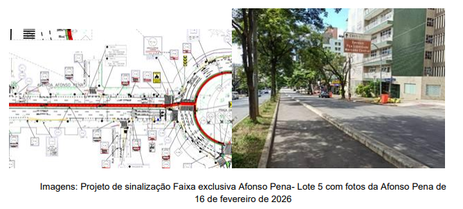

**4- Semáforo Rua Ramalhete**

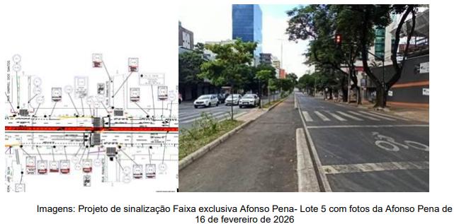

O cruzamento com a rua Muzambinho é o mais perigoso, pois os carros que sobem podem retornar ou virar na Muzambinho. Já o ciclista que desce pode ficar sem saber se o semáforo está aberto para ele e quando o ciclista está subindo, não existe campo de visão, como pode ser visto nas fotos abaixo:

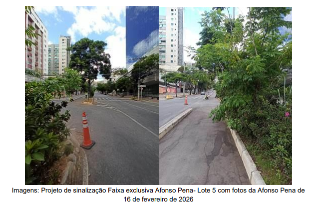

A ausência dessa sinalização mínima obrigatória transforma a ciclovia em um espaço inseguro, gerando conflitos com veículos motorizados e pedestres, além de não orientar adequadamente os próprios ciclistas.  
  
**II – TEMPESTIVIDADE PARA O MANDAMUS**  
  
As primeiras tratativas com a SUDECAP se deram em novembro de 2025, com os Tickets 31.00910856/2025-20 e 3100910877/2025-35, que originaram o Ofício SUDECAP/EXT nº312/2025, de 26/11/2025, conforme cabeçalho adiante

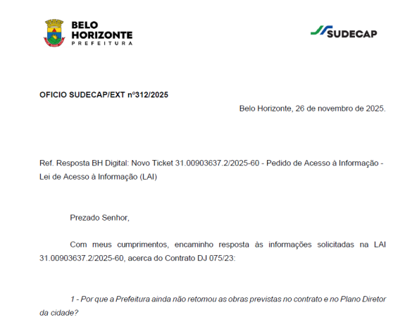

Logo, o prazo previsto no art. 23 da Lei nº 12.016/09 se encerrará em 26/03/2026, estando apta a presente distribuição da segurança.  
  
Além do mais, conforme reiteradas decisões da jurisprudência, “o mandado de segurança impetrado contra ato omissivo da Administração não está submetido ao instituto da decadência, porquanto seus efeitos se verificam continuamente, ou seja,  
a cada dia que a administração deixa de agir.”  
  
**III - LEGITIMIDADE E INTERESSE DE AGIR**  
Como é cediço a legitimidade consiste na pertinência subjetiva da ação e refere-se à titularidade dos interesses em conflito, pois no polo ativo da relação jurídico-processual, deve figurar o titular da pretensão resistida e, no polo passivo, o que resiste à pretensão.  
  
Como nos ensina Marcelo Sciorilli, “Os direitos individuais homogêneos não são coletivos na sua substância, ou essencialmente coletivos, porque a eles não se aplicam as qualificações de transindividuais nem indivisíveis, sendo, ao contrário, considerados coletivos apenas para efeito de sua defesa em juízo, de forma conjunta, pelo que apenas acidentalmente podem dizer-se coletivos.”  
  
Conforme dizia o falecido Ministro Teori Zavascki, deve-se diferenciar tutela de direitos coletivos e tutela coletiva de direitos. No primeiro caso, remete-se ao tratamento judiciário destinado aos direitos transindividuais (direitos essencialmente coletivos, que ultrapassam a órbita individual – caracterizados pela indeterminabilidade dos sujeitos e indivisibilidade do  
objeto); no segundo caso, remete-se a uma técnica processual que permite coletivizar a proteção de demandas subjetivas individuais, mediante um procedimento diferenciado (demandas individuais, que, em razão de sua homogeneidade, origem comum, economia processual, isonomia, segurança jurídica, são tuteladas coletivamente).  
  
Assim, determinadas categorias de direito podem ser exercidas individualmente ou coletivamente.  
  
A regra geral contida no art. 18 do CPC, veda pleitear direito alheio em nome próprio, trouxe no mesmo comando a possibilidade de sua relativização, sendo certo que o objeto da presente ação se encaixa exatamente na regra flexibilizada, em decorrência da natureza do direito pleiteado.  
  
Nesta linha, dispõe o § 3º do art. 1° da Lei nº 12016/09 que:  
  
Art. 1º Conceder-se-á mandado de segurança para proteger direito líquido e certo, não amparado por habeas corpus ou habeas data, sempre que, ilegalmente ou com abuso de poder, qualquer pessoa física ou jurídica sofrer violação ou houver justo receio de sofrê-la por parte de autoridade, seja de que categoria for e sejam quais forem as funções que exerça.(…)  
  
§ 3o Quando o direito ameaçado ou violado couber a várias pessoas, qualquer delas poderá requerer o mandado de segurança.(…)  
  
Assim, “no mandado de segurança, para fins de legitimidade ativa, há de ser o impetrante o possível titular do direito individual ou coletivo líquido e certo para o qual se pede a proteção do remédio heroico.  
  
No caso dos autos, como se verá adiante, a legitimidade ativa do impetrante é cristalina, pois de trata de bem público de uso coletivo.  
  
A ciclovia da Afonso Pena está prevista no Plano Diretor (Lei 11.189/19) de Belo Horizonte e, portanto, precisa ser implementada. Foram anos de elaboração, de consultas e participação social que culminaram no projeto de requalificação da Afonso Pena.  
  
É fácil perceber que o excesso de cautela manifesto pela PBH para não dar continuidade às obras, extrapola o bom senso e a própria petição do MPMG, pois inexiste demanda para que o equipamento público seja desfeito, de forma que a Prefeitura tem o dever de continuar com as obras e principalmente sinalizar o que já foi concluído.  
  
Também resta claro que o fim do prazo contratual não configurou impeditivo para que a BHTRANS continuasse com as sinalizações das faixas de ônibus e a própria Sudecap confirmou que é atribuição do órgão viabilizar as sinalizações da ciclovia.  
  
Por fim, a segurança viária é dever do Estado e direito de todos, cabendo ao órgão de trânsito com circunscrição sobre a via implantar, sinalizar e fiscalizar as vias, garantindo a incolumidade dos usuários.  
  
A omissão da autoridade coatora fere o ordenamento jurídico pátrio, notadamente os seguintes dispositivos:  
  
**a) Código de Trânsito Brasileiro (Lei n° 9.503/97):**  
Art. 1º, § 2º e § 5º: Estabelece que o trânsito seguro é direito de todos e dever dos órgãos do Sistema Nacional de Trânsito, cabendo a estes a adoção das medidas destinadas a assegurar esse direito. A omissão na sinalização viola frontalmente este princípio.  
  
Art. 2º: Aplica-se às vias terrestres abertas à circulação o CTB, incluindo as ciclovias, que são vias de circulação de veículos não motorizados.  
  
Art. 80: Determina que "toda via urbana ou rural deverá apresentar, obrigatoriamente, sinalização vertical e horizontal, sempre que necessário à segurança". No caso em tela, a necessidade é patente e incontestável, dado o risco de acidentes .  
  
Art. 90, § 1º, inciso II: Afirma que a implantação da sinalização de trânsito deve seguir as normas e critérios estabelecidos pelo CONTRAN, garantindo a padronização e a segurança.  
  
Art. 105, inciso VI: Embora trate dos equipamentos obrigatórios das bicicletas (campainha, sinalização noturna, etc.), este artigo reforça a lógica de que a via deve estar preparada para receber o ciclista, que por sua vez já possui obrigações legais .  
  
**b) Resoluções do CONTRAN e Normas Técnicas:**  
Resolução CONTRAN n° 160/2004 (e atualizações) / Manual Brasileiro de Sinalização de Trânsito – Volume VIII (Sinalização Cicloviária): Este é o fundamento técnico mais importante. O volume específico do Manual do CONTRAN, plenamente aplicável, determina os critérios para a sinalização de espaços cicloviários. Ele estabelece a obrigatoriedade do uso da sinalização vertical de regulamentação (R-34 – "Circulação exclusiva de bicicleta") no início de toda ciclovia e ciclofaixa, bem como da sinalização de advertência (A-30B) nos cruzamentos para alertar os condutores de veículos motorizados sobre a passagem de ciclistas.  
Norma ABNT NBR 16071-3: Estabelece os padrões de visibilidade e dimensões das placas  
de sinalização para ciclovias, como altura de instalação (entre 1,80m e 2,20m) e distância de  
percepção, requisitos que a via em questão não atende .  
  
**c) Política Nacional de Mobilidade Urbana (Lei n° 12.587/2012):**  
Art. 5º: A referida lei estabelece como diretrizes a acessibilidade universal e a segurança nos deslocamentos das pessoas. A falta de sinalização compromete esses fundamentos, priorizando o modal individual motorizado em detrimento do ciclista .  
  
Art. 6º, inciso II: Define como objetivo da política nacional reduzir os custos ambientais e socioeconômicos dos deslocamentos, o que passa, obrigatoriamente, pela proteção e incentivo ao uso da bicicleta através de infraestrutura adequada.

Presentes os requisitos autorizadores para a concessão da medida liminar, previstos no art. 7º, III, da Lei 12.016/2009, quais sejam, a relevância dos fundamentos (fumaça do bom direito) e a possibilidade de ineficácia da medida (perigo na demora), conforme se demonstra:  
  
O fumus boni iuris resta evidenciado pela clara violação a dispositivos legais que impõem ao Poder Público o dever de garantir a segurança no trânsito. A ausência de sinalização afronta o art. 1º, §2º, do Código de Trânsito Brasileiro (Lei 9.503/97) , que estabelece a segurança como princípio fundamental, e o art. 80, que determina que 'sempre que necessário, será colocada ao longo da via, sinalização prevista neste Código e em legislação complementar'. Viola, ainda, os preceitos do Manual Brasileiro de Sinalização de Trânsito (CONTRAN), que regulamenta a técnica aplicável a vias cicláveis, e o dever constitucional de garantir a  
mobilidade urbana sustentável e segura (arts. 5º, caput e 6º da CF/88)  
  
A medida pleiteada é plenamente viável e proporcional, pois se trata de atividade rotineira e inerente às funções do órgão de trânsito (BHTrans). A implantação de sinalização, tanto vertical quanto horizontal, é serviço corriqueiro para o qual o poder público já dispõe de material, equipe técnica e expertise, não configurando, portanto, qualquer ônus extraordinário ou desproporcional aos cofres públicos, mas sim o cumprimento de um dever básico.  
  
Inclusive, é provável que esse serviço possa ser feito de forma concomitante às sinalizações para as faixas de ônibus do mesmo projeto da ciclovia, que a BHTRANAS promete finalizar depois do Carnaval.  
  
O periculum in mora é evidente e se materializa no risco concreto e iminente de dano irreparável ou de difícil reparação à vida e à incolumidade física dos usuários. A cada dia sem a devida sinalização, ciclistas, como o Impetrante e sua família, são obrigados a compartilhar o espaço de forma insegura com veículos motorizados que não são advertidos da existência da via exclusiva. Essa omissão gera não apenas o risco de colisões, mas também a desorientação dos próprios ciclistas dentro do espaço a eles destinado, configurando uma verdadeira 'armadilha' urbana. O direito fundamental à vida (art. 5º, caput, CF) e o direito à  
segurança no trânsito se sobrepõem a qualquer interesse meramente administrativo ou a protelações injustificadas da Administração Pública

Diante do exposto, requer-se, in limine litis, com fulcro no art. 7º, III, da Lei 12.016/2009, seja concedida a medida liminar para determinar à autoridade coatora que, no prazo máximo de 10 (dez) dias, providencie a imediata implantação da sinalização horizontal e vertical em toda a extensão da ciclovia da Afonso Pena já concluída entre a Praça da Bandeira e o quarteirão  
após a rua Muzambinho, nos termos do Código de Trânsito Brasileiro e do Manual de Sinalização do CONTRAN, sob pena de multa diária (astreintes) no valor de R\$ 5.000,00 a ser arbitrada por este juízo em caso de descumprimento, sem prejuízo da responsabilização da autoridade coatora.  
  
**VI.I - Diante do exposto, requer-se:**  
  
a) A concessão de medida liminar, inaudita altera pars (sem a oitiva da parte contrária), para determinar à autoridade coatora que, no prazo máximo de 10 dias, promova a imediata implantação da sinalização viária (vertical e/ou horizontal) em toda a extensão da ciclovia da Afonso Pena já concluída entre a Praça da Bandeira e o quarteirão após a rua Muzambinho, nos termos do Código de Trânsito Brasileiro e do Manual de Sinalização do CONTRAN, sob pena de multa diária (astreintes) no valor de R\$ 5.000,00 (cinco mil reais), sem prejuízo da responsabilização da autoridade coatora.  
  
b) De igual modo, que seja determinado às autoridades coatoras, que se abstenham de promover quaisquer alterações nas ciclovias já implantadas no trecho acima, que possam caracterizar a retirada ou desfazimento das obras já concluídas entre a Praça da Bandeira e o quarteirão após a rua Muzambinho.  
  
c) A concessão definitiva da segurança, ao final, para tornar permanente a obrigação de implantar e manter a adequada sinalização na via ciclável, confirmando-se a liminar eventualmente concedida
