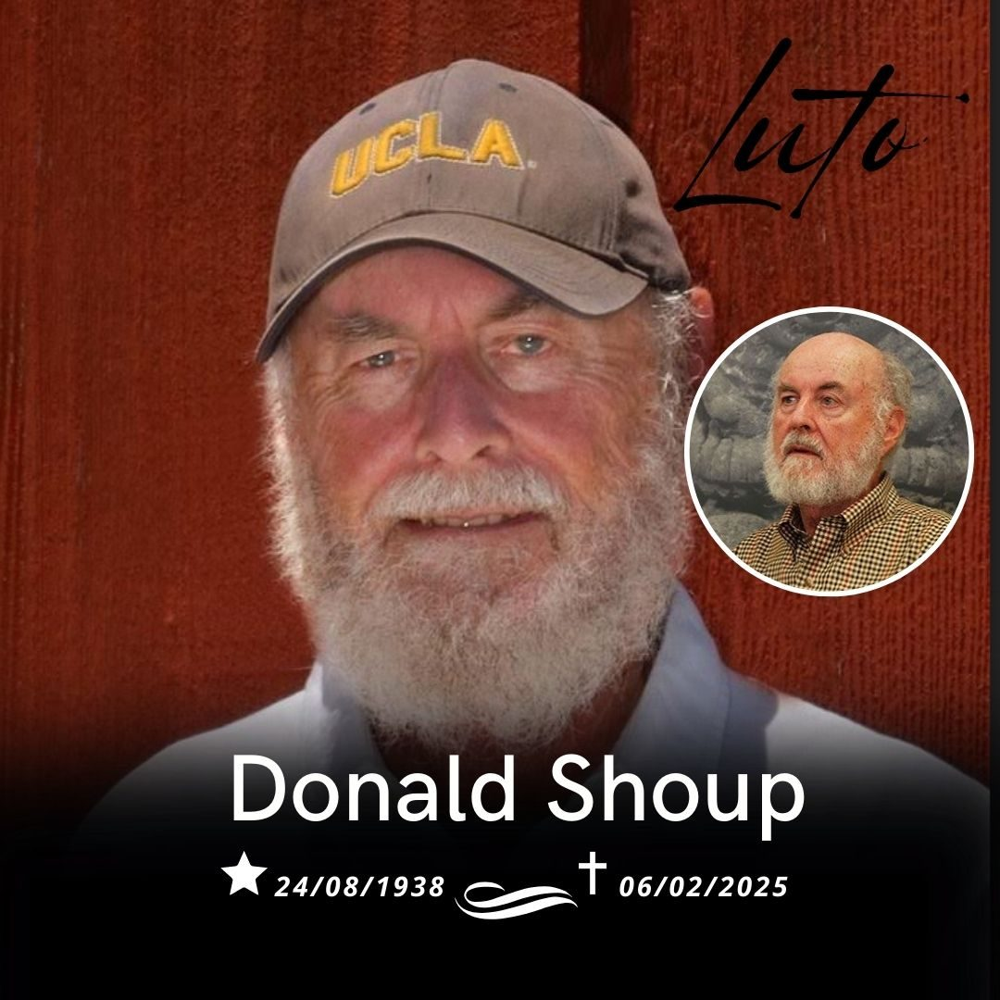
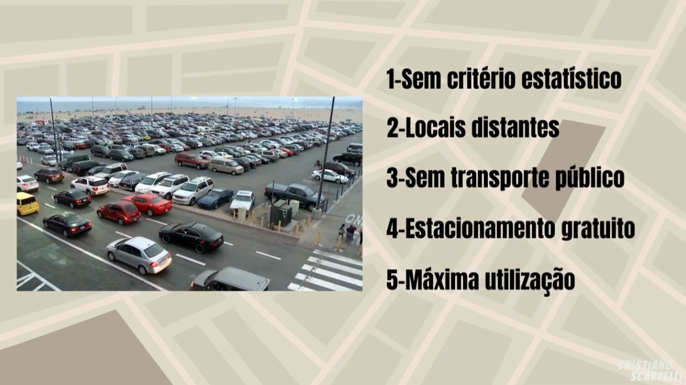
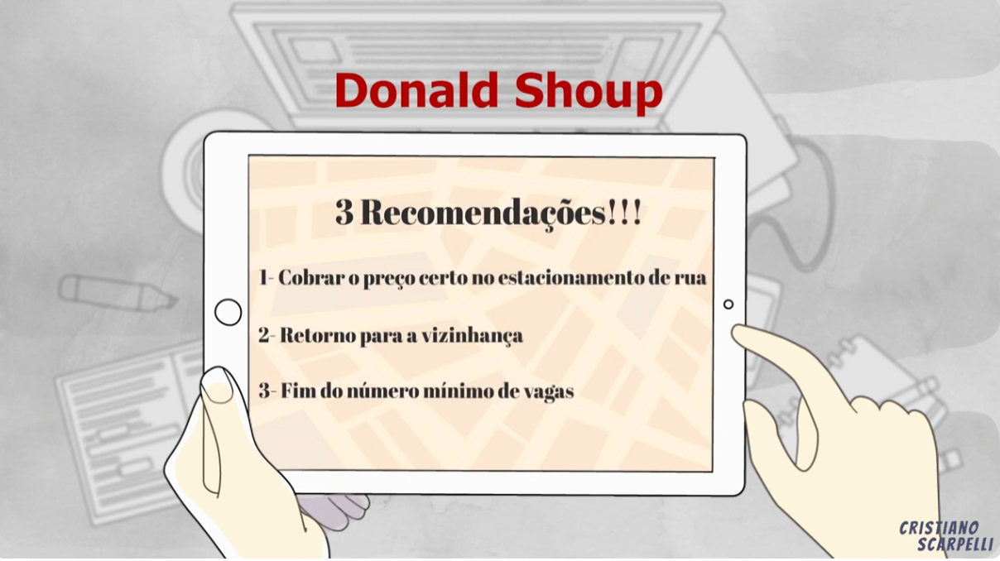
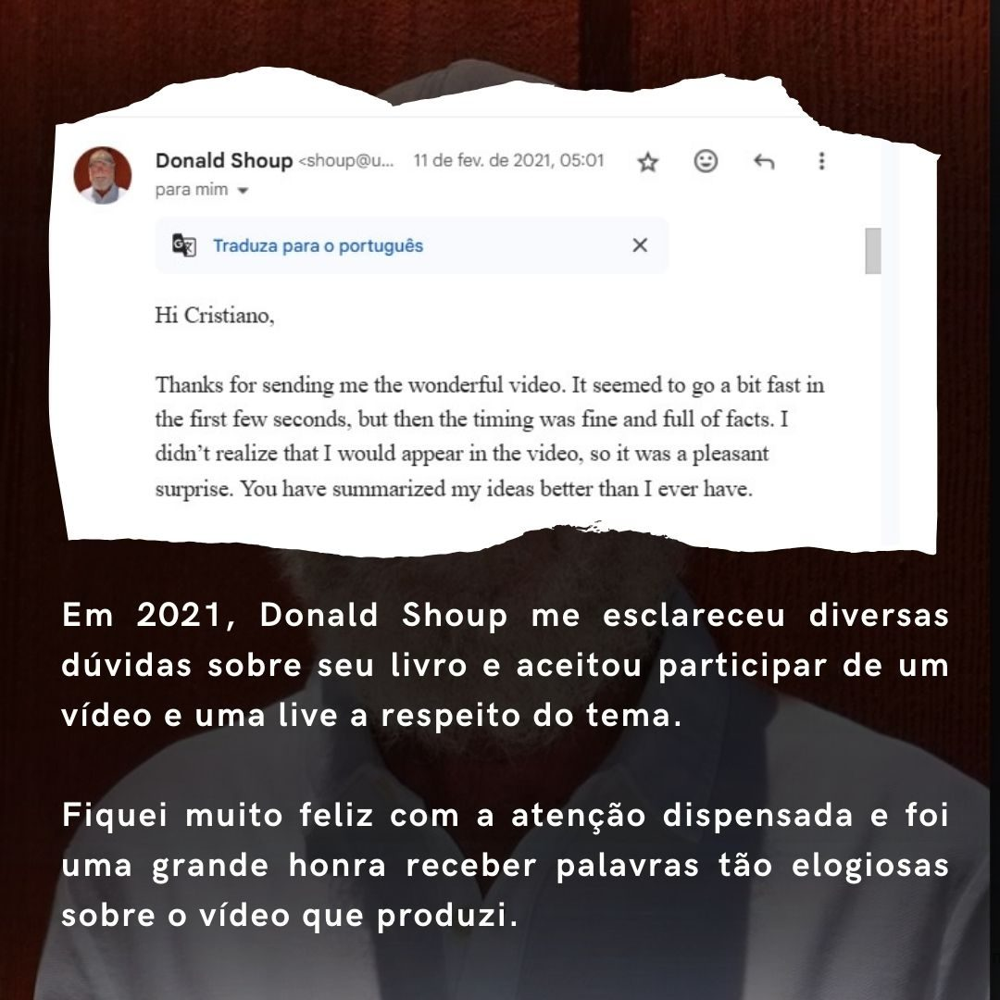

No dia 06 de fevereiro de 2025, faleceu o brilhante Donald Shoup, a maior referência no tema dos estacionamentos. Shoup foi professor de planejamento urbano na Universidade da Califórnia (UCLA) e dizia que as disputas acadêmicas internas por temas de prestígio acabaram lhe empurrando para a investigação de temas de menor expressão à época.

Inspirado por uma tese de mestrado que descobriu que funcionários de um condado de Los Angeles tinham duas vezes mais probabilidade de dirigirem desacompanhados, apenas por conta da disponibilidade de estacionamento gratuito, instigou Shoup a debruçar-se sobre o tema do estacionamento. Foram décadas pesquisando e escrevendo artigos sobre as disfuncionalidades de legislações criadas para tentar regrar a oferta de estacionamentos, as quais resultaram em sérios problemas urbanos, econômicos e ambientais.

Em 2005, publicou sua obra seminal, o livro “O alto custo do estacionamento gratuito”, um calhamaço de mais de 900 páginas, o qual sintetiza grande parte do seu pensamento.

Donald Shoup conseguiu me impressionar com sua maestria. O seu livro é uma obra-prima! Com linguagem simples, acessível e muitas vezes divertida, Shoup não perde o rigor técnico e se vale da economia, história e urbanismo para retratar os diversos problemas advindos do excesso de vagas de estacionamento nas cidades. 

Vídeo Custo Social dos Estacionamentos

A perspectiva histórica trazida por Donald Shoup nos ajuda a entender um pouco como se conformou a tragédia de cidades dominadas por carros e estacionamentos.

No início do século 20, à medida que o uso do automóvel foi-se expandindo, as cidades tiveram que enfrentar o desafio de achar espaço para os carros não apenas para o seu uso, mas principalmente para o seu não uso, já que, conforme o autor, os carros passam 95% do tempo vazios (estacionados).

Governantes, então, se depararam com o seguinte dilema: espaço de guarda e depósito de um veículo de transporte particular é uma responsabilidade exclusivamente privada ou deve ser encarado como um direito natural básico que o Estado também tem responsabilidade de ofertar? À época, Shoup relata que não foram poucos os economistas e planejadores que alertaram que a melhor opção era a primeira. 

Carro e estacionamento são vistos como direito natural ou até divino - Vídeo Custo Social dos Estacionamentos

Em 1925, Millher McClintock defendeu que, se o estacionamento grátis não fosse ofertado, as pessoas avaliariam suas opções de transporte levando em conta seus verdadeiros custos. Dessa forma, quem quisesse se deslocar por automóvel a determinado local poderia continuar a fazê-lo, mas necessariamente iria contabilizar os custos com estacionamento para avaliar a conveniência dessa opção. Da mesma forma, os donos de imóveis teriam que decidir se achavam mais vantajoso utilizar suas propriedades para construir residências, atividades comerciais/industriais ou para depósito e guarda de veículos.

A sugestão é tratar estacionamentos como tratamos restaurantes. Planejadores não determinam quantos restaurantes devem existir na cidade. Deixa-se o mercado prover, de forma que o consumidor tenha a opção de não pagar por um bem caso não o queira.

Quando a cidade requisita mais estacionamento do que se pretende oferecer voluntariamente, o resultado é um subsídio aos proprietários de carros e um incentivo para que cada vez mais gente queira usar esse modo de transporte. Afinal, quem não fizer uso do estacionamento não ganhará nada com isso, perderá espaço precioso da via e eventualmente ainda arcará com o custo do estacionamento embutido nos preços das mercadorias.

O custo do estacionamento fica embutido no preço das mercadorias - Vídeo Custo Social dos Estacionamentos

Esse princípio básico da economia foi seguido pela cidade de Los Angeles em abril de 1920, quando o prefeito decidiu banir os estacionamentos em vias públicas e obteve resultados incríveis na melhoria do tráfego. Entretanto, a iniciativa durou apenas 19 dias, pois os motoristas, já acostumados com seu “direito natural” ao estacionamento, começaram a reclamar da medida e ficou politicamente insustentável mantê-la.

A partir de então, abandona-se a ideia de estacionamento como um custo privado, e a opção por encarar os estacionamentos como direito natural básico se consolida e se expande. Surge então um novo desafio. As vias públicas tinham agora que acomodar não apenas um volume crescente de carros trafegando, mas também muitas vagas de estacionamento em vias públicas.

Para tentar solucionar esse problema, comete-se o segundo grande erro. Com o intuito de desafogar as ruas, o poder público passou a exigir que todo tipo de estabelecimento público ou privado fosse obrigado a disponibilizar um número mínimo de vagas de estacionamento. Para piorar, a escolha do número mínimo de vagas foi feita sem nenhum embasamento técnico, as amostras eram estatisticamente inadequadas, colhidas em locais distantes, sem transporte público e em períodos de alta demanda, o que resultou em exigências superestimadas do número mínimo de vagas.

Vídeo Custo Social dos Estacionamentos

Essa regra fez explodir o número de estacionamento nas cidades. Jackson, capital do Mississipi, tem por volta de 27 vagas de estacionamento para cada residência. Nos EUA, Shoup cita estimativas de estudos que apontam para a existência de 3 a 5 vagas de estacionamento para cada automóvel. 

Vale lembrar que cada vaga também demanda espaço de circulação e manobra, o que acaba por dobrar a área destinada aos veículos. Com isso, não raro, o espaço residencial destinado a pessoas é menor do que o destinado a carros. Em termos de espaço urbanos, John Kain estimou que algumas cidades destinam mais de 50% do espaço construído para garagens e ruas.

As consequências são trágicas e levam a um processo de retroalimentação negativa. Mais carros leva a mais trânsito, a mais estacionamentos, à diminuição da densidade urbana e a um maior espraiamento da mancha urbana. E com cada uma dessas variáveis se retroalimentando, após um tempo, o poder público entendia que era preciso um novo aumento na exigência do número mínimo de vagas.

Por fim, para lidar com esses problemas, Shoup elaborou três recomendações de políticas públicas:

1- Cobrar o preço certo pelo estacionamento nas vias públicas. A sua ideia é que esse preço deva ficar num patamar em que as vagas públicas tenham uma taxa de ocupação perto de 85%, de forma que caso alguém queira estacionar, não precise ficar dando volta nos quarteirões à procura de vagas;

2- A segunda recomendação é que os recursos arrecadados sejam destinados a benefícios no entorno da Zona Azul, como a concessão de Wi-Fi grátis, mais limpeza urbana, policiamento, bicicletas compartilhadas ou concessão de transporte público gratuito para os funcionários da localidade;

3- Por último, Shoup sugere que os gestores removam a famigerada exigência de número mínimo de vagas.

Vídeo Custo Social dos Estacionamentos

Essas são apenas algumas das muitas ideias reveladoras e empolgantes presentes no livro de Donald Shoup. A sua capacidade de dissecar de forma brilhante um tema aparentemente marginal e pouco expressivo lhe rendeu não apenas um merecido reconhecimento internacional, mas até mesmo uma legião de adeptos de suas ideias que se sentem orgulhosos em se autodefinirem como “[Shoupistas](https://www.facebook.com/groups/70015940360/)”.  

Ao ler a sua obra, confesso que também me senti um “Shoupista” e me atribuí uma missão. Ideias tão fascinantes deveriam ser mais bem divulgadas através de um vídeo e me propus a tentar a empreitada. Para viabilizar minha produção, tentei contato com o próprio Donald Shoup, o qual foi solícito e me ajudou de diversas formas. A principal delas foi ter topado me conceder uma entrevista, a qual serviu para enriquecer e concluir [o vídeo resumo de sua obra](https://youtu.be/t0XAw83Slbk?si=PRIl4vEhWG-3r87r) e ainda permitiu que eu publicasse um [segundo conteúdo](https://www.youtube.com/watch?v=vd0Kw4YLW2o&t=1s).

Vídeo Custo Social dos Estacionamentos

O acesso a pessoas com prestígio não costuma ser fácil e no meio acadêmico isso não é diferente. Na produção desse e outros trabalhos tentei contato com outros figurões da academia e o mais comum sempre foi o silêncio ou respostas evasivas. Já Donald Shoup deu toda a atenção a um completo desconhecido, de outra nacionalidade, e mostrou uma disposição alegre e genuína em ajudar. 

Email trocado entre Donald Shoup e Cristiano Scarpelli

Tudo isso me fez refletir que as relevantes contribuições acadêmicas de Donald Shoup, sua trajetória brilhante e reconhecida competência, podem ter sido forjadas porque ele era antes de tudo um apaixonado por pesquisar, aprender e repassar o conhecimento. Um acadêmico por vocação!
