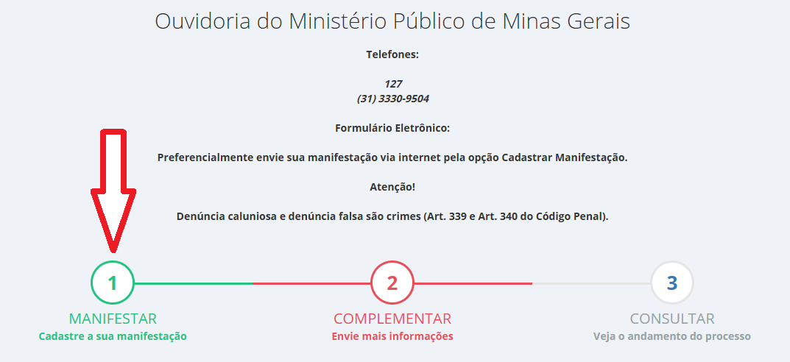

**Ação 1: Assinar o [abaixo-assinado](https://www.change.org/p/apoio-%C3%A0-constru%C3%A7%C3%A3o-da-ciclovia-na-afonso-pena) em apoio à ciclovia do Fuad na Afonso Pena.**

O abaixo-assinado foi organizado pela Dona Ana Lúcia de 78 anos, a fim de propiciar mais segurança a todos que pedalam na cidade. Além disso, permite que mais pessoas venham a optar pelo uso da bicicleta, o que traz benefícios para toda a cidade.

**Ação 2: Usar a Lei de Acesso à informação para questionar por que a Prefeitura ainda não retomou as obras**

Primeiro acesse o [site da Lei de Acesso à informação](https://prefeitura.pbh.gov.br/lei-de-acesso-a-informacao).

Clique em solicitar informação:

Clique em solicitar:

Sugestão de texto para a sua solicitação:

Em 15 de Setembro, o juiz Danilo Couto Lobato Bicalho rejeitou o pleito do Ministério Público para a prefeitura não implementar a ciclovia da Afonso Pena sem prévio licenciamento urbanístico. O processo tramita sob o nº 5077901-10.2024.8.13.0024. Com isso, desde aquela data não existe nenhum impedimento para que a prefeitura retome as obras e execute o contrato 01202327000182 licitado para execução das obras. Isso posto, gostaria de saber:

1- Por que a Prefeitura ainda não retomou as obras previstas no contrato e no Plano Diretor da cidade?

2- Por que a BHTRANS ainda não providenciou a sinalização horizontal (pintura e pictograma de bicicleta) e sinalização vertical (Placa R-34), do trecho já concluído da ciclovia da Afonso Pena entre a Praça da Bandeira e o TJMG, bem como a colocação da placa A-30B e instalação semafórica para ciclistas na travessia do cruzamento da ciclovia com a rua Muzambinho?

3- Em 15/07/25, a Prefeitura publicou o aditivo DJ-075/23 ao contrato 01202327000182, prorrogando o prazo de vigência do contrato até 03/06/2026, o que inclusive consta no Portal da Transparência. (https://grp.pbh.gov.br/bh_prd_transparencia/web/contrato-iframe.html?CttNumero=01202327000182#!/home). A prefeitura pretende levar adiante a obra da ciclovia dentro do novo prazo estabelecido?

**Ação 3: Solicitar à BHTRANS para que providencie a sinalização dos trechos onde a ciclovia já foi concluída entre a Praça da Bandeira e o TJMG.**

Em primeiro lugar acesse: <https://servicos.pbh.gov.br/home>

Na aba de pesquisa escreva “sinalização horizontal”:

Vá em solicitar:

Você pode escolher se prefere denunciar se identificando ou de forma anônima.

Em seguida, preencha o nome do Logradouro com "Afonso Pena" e no campo o número pode colocar "4121"

Na descrição sugiro o texto a seguir: "Solicito à BHTRANS para que realize a imediata sinalização horizontal (pintura e pictograma de bicicleta) e sinalização vertical (Placa R-34), do trecho já concluído da ciclovia da Afonso Pena entre a Praça da Bandeira e o TJMG, bem como a colocação da placa A-30B e instalação semafórica para ciclistas na travessia do cruzamento da ciclovia com a rua Muzambinho.

Em 15 de Setembro, o juiz Danilo Bicalho negou o pedido do MPMG para paralisar as obras da ciclovia e por isso a Prefeitura tem agora obrigação de seguir o previsto no Plano Diretor e realizar a devida sinalização para seguir o Código de Trânsito Brasileiro, não prejudicar a segurança dos usuários da via e causar prejuízo ao erário e ao patrimônio público por não finalizar a obra".

Após finalizar, repita todo o processo do passo 3, escrevendo "sinalização vertical" na aba de pesquisa do Portal da Prefeitura.

**Ação 4: Provocar o Ministério Público para que exija da PBH a retomada das obras e providencie a devida sinalização dos trechos já concluídos**

Caso você receba alguma resposta negativas às ações 2 ou 3, sugiro provocar o Ministério Público para que exija ou investigue os administradores públicos que estão se recusando a cumprir com o Plano Diretor, garantir a correta sinalização da via prevista pelo Código de Trânsito e dar continuidade ao contrato 01202327000182.

Para isso, acesse o [site da Ouvidoria do Ministério Público](https://www.mpmg.mp.br/portal/menu/conheca-o-mpmg/ouvidoria/)

Vá em registro de manifestações e denúncias online:

Escolha a opção 1:

Em seguida, preencha os seus dados pessoais e de contato.

O próximo passo é preencher os dados da Manifestação anteriormente enviada através da LAI ou da solicitação de sinalização.

Nessa parte, o mais importante é a descriação do fato e da solicitação. No caso de identificar que a Prefeitura está atrasando ou se recusando a levar adiante as obras da ciclovia do Fuad na Afonso Pena sugiro o seguinte texto:

"Por conta da ação civil pública 5077901-10.2024.8.13.0024, a prefeitura estava impedida de prosseguir com as obras da ciclovia da Afonso Pena por conta de decisão liminar que obrigou à paralisação das obras até que fosse realizado licenciamento urbanístico.

Em 22 de Agosto de 2025 através do contrato aditivo 03, publicado na edição 7295 do Diário Oficial em 11/07/2025, a PBH prorrogou o prazo de execução das obras de requalificação da Afonso Pena para 03/06/2026 e adicionou algumas alterações.

Ocorre que no dia 15 de Setembro, o juiz responsável pelo caso, Danilo Couto Lobato Bicalho, decidiu que as obras da ciclovia podem continuar, de forma que até o presente momento não existem óbices à continuidade das obras.

Todavia, conforme resposta ao ofício xxxxxxxxxxxxxxx (colocar o número do ofício da LAI enviado anteriormente), a prefeitura tem protelado a retomada das obras, o que pode comprometer a execução do contrato 01202327000182 ou ainda mais grave, não fazer valer o previsto no Plano Diretor da cidade.

Vale ressaltar que as intervenções restantes a serem executadas são quase que inteiramente em cima do canteiro central (o que inclusive entendo que dispensaria o controverso licenciamento urbanístico discutido no processo), não havendo mais previsão de supressão de faixas de rolamento dos motorizados, além de impacto viário mínimo quando das obras."

Em seguida, na parte da descrição do que se espera que o MPMG faça, sugiro o seguinte texto:

"Solicito ao MPMG que:

1- Exija da PBH a retomada imediata das obras da ciclovia previstas no contrato 01202327000182, garantindo o cumprimento do Plano Diretor, maior segurança na via para quem pedala e para que não haja prejuízo ao erário, já que investimentos e recursos foram dispendidos e licitados".

Caso queira denunciar a falta de iniciativa do poder público em sinalizar a parte em que a ciclovia já foi concluída, sugiro o seguinte texto:

"A ciclovia da Afonso Pena teve suas obras paralisadas por conta da Ação Civil Pública no. 5077901-10.2024.8.13.0024.

Até o momento da paralisação, a obra da ciclovia ficou pronta desde a Praça da Bandeira até bem perto do quarteirão da rua Trifana, faltando apenas providenciar a devida sinalização horizontal e vertical tal como previsto no Código de Trânsito Brasileiro.

Entretanto, em 15 de Setembro, o juiz Danilo Bicalho negou o pedido do MPMG para paralisar as obras da ciclovia e por isso a Prefeitura pode prosseguir com as obras e a sinalização do local a fim e de não prejudicar a segurança dos usuários da ciclovia ou causar prejuízo ao erário, à vida e ao patrimônio público por não finalizar o trecho da forma prevista no código de trânsito.

Para atender a essa demanda específica, já abri os chamados xxxxxxxxxx (Sinalização horizontal) e xxxxxxxxxxxxxx (sinalização vertical), mas a prefeitura ainda não providenciou a devida sinalização prevista no Código de Trânsito Brasileiro.

A intervenção é o corolário do que consta nas justificativas do contrato aditivo 03, publicado na edição 7295 do Diário Oficial em 11/07/2025, no qual a Prefeitura sugere ser necessário readequações nas intervenções do Projeto da Afonso Pena para a obra não ficar com aspecto de inacabada.

Portanto, resta claro que pinturas e sinalizações coadunam com os objetivos citados no aditivo 03, além de serem intervenções bem mais simples e que são rotineiramente realizadas pela BHTRANS, estando perfeitamente de acordo com as justificativas anteriores apresentadas pelo poder público".

Por fim, como exigência das providências a serem tomadas, sugiro o seguinte:

"Exija que a BHTRANS ou a SUDECAP realize a imediata sinalização horizontal (pintura e pictograma de bicicleta) e sinalização vertical (Placa R-34), do trecho já concluído da ciclovia da Afonso Pena entre a Praça da Bandeira e o TJMG, bem como a colocação da placa A-30B e instalação semafórica para ciclistas no cruzamento com a rua Muzambinho tal qual previsto no CTB e para que a obra não fique com aspecto de inacabada tal qual previsto no contrato aditivo 03".

**Ação 05: Solicite ao seu vereador para que pressione a Prefeitura fazer valer o Plano Diretor e retomar as obras da ciclovia do Fuad na Afonso Pena**

O vereador em quem você votou foi eleito? Tem algum vereador que você tenha um bom contato?

Pois bem, solicite a ele que também envie os ofícios acima e pressione a prefeitura pela retomada das obras e a correta sinalização dos trechos que a ciclovia já foi concluída.
