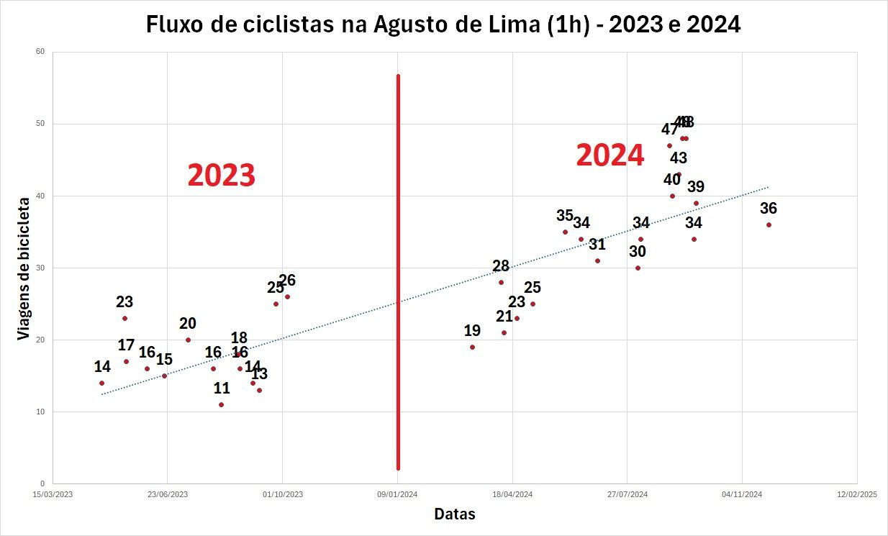

Nos anos de 2023 e 2024, realizei na Augusto de Lima, 6 contanges de ciclistas com 24h de duração e 32 contagens de 1h de duração (18h-19h). Uma <a href="/artigo/em-apenas-um-ano-viagens-de-bicicleta-quase-triplicam-na-ciclovia-da-augusto-de-lima/" data-type="link" data-id="/artigo/em-apenas-um-ano-viagens-de-bicicleta-quase-triplicam-na-ciclovia-da-augusto-de-lima/">análise detalhada</a> dos dados foi divulgada anteriormente e constatou que a ciclovia em conjunto com a adoção das bicicletas compartilhadas pode ter levado a dobrar o fluxo de ciclistas na avenida e quase triplicar na ciclovia.

Este possível aumento no fluxo de ciclistas foi verificado tanto pelas contagens de 24h como pelas de 1h. No caso dos registros de 1h realizados perto da Praça Raul Soares, a média registrada em 2023 foi de 17 ciclistas e em 2024 o resultado foi uma média de 34 ciclistas.

Há que se pontuar que nem sempre a média representa bem a dinâmica das mudanças, pois desde a implementação da ciclovia, observou-se um forte viés de alta dos números, especialmente ao longo de 2024 (com exceção de novembro).

Uma outra interessante forma de comparar esses dados é através da chamada simulação de Monte Carlo, onde através de simulações realizadas por computador, pode-se visualizar certas diferenças entre as observações realizadas.

No caso, resolvi comparar as 14 observações de ciclistas de 2023 com as 18 observações de 2024, buscando mensurar a proporção de vezes em que os números de 2024 foram maiores do que os de 2023.

Para isso, rodei o código disponível ao final do texto no programa Rstudio, o qual simula uma série de sorteios aleatórios dos dados de cada ano e ao final, quantifica quantas vezes as observações sorteadas em 2024 foram maiores do que as observações sorteadas em 2023.

**Os resultados demonstram que perto de 95% das vezes, o número de ciclistas observado no ano de 2024 foi maior do que em 2023.**

*\## Códigos##*

*\## SImulação de Monte Carlo para dados da Augusto de Lima##*

*\##Dados Augusto de Lima 2023 e 2024##*

*AL = c(14,23,17,16,15,20,16,11,18,16,14,13,25,26)*

*AL2 \<- c(19, 28, 21, 23, 25, 35, 34, 31,30,34,47,40,43,48,48,39,34,36)*

*\##Código Simulação##*

*numero_simulacoes \<- 100000 \# Número de simulações*

*\# Contador para contar quantas vezes o valor do grupo A é maior que o do grupo B*

*contador \<- 0*

*\## Loop para simular as retiradas e comparações*

*for (i in 1:numero_simulacoes) {*

*  \# Retirar um item aleatório de cada grupo*

*  amostra_A \<- sample(AL, 1)*

*  amostra_B \<- sample(AL2, 1)*

*  \# \# Comparar as amostras e atualizar o contador*

*  if (amostra_B \> amostra_A) {*

*    contador \<- contador + 1*

*  }}*

*\## Calcular a proporção de vezes que o valor do grupo A é maior que o do grupo B*

*proporcao \<- contador / numero_simulacoes*

*cat("Proporção de vezes que o valor do grupo B é maior que o do grupo A:", proporcao)*
