Resposta ao <a href="https://drive.google.com/file/d/1BL_Q1qCVLDXAE8R38_ZeJsBqbOSMRPHM/view?usp=sharing" data-type="link" data-id="https://drive.google.com/file/d/1BL_Q1qCVLDXAE8R38_ZeJsBqbOSMRPHM/view?usp=sharing">Relatório Técnico da BHTRANS/DSV/GECIP</a> N° 011/2024 de 16 de dezembro de 2024, relativo ao Inquérito Civil - 03.16.0024.0116538.2024-48

**ASSUNTO: Avaliação da possibilidade de deslocamento do semáforo atualmente existente na Rua Nair com Via-710 para ponto de maior visibilidade para motoristas, ciclistas e pedestres, bem como de registro de avanço, ou outra medida que garanta a segurança da trafegabilidade no local**

**<u>1- Considerações Iniciais</u>**

Antes de tudo, queremos destacar que devido ao grande perigo existente na travessia sem visibilidade, que se encontra junto ao semáforo existente na Rua Nair com Via-710, ao longo deste parecer, denominamos o local de travessia da morte ou travessia em ponto cego.

Também devemos pontuar que neste parecer, denominamos “técnicos da BHTRANS”, a todos profissionais envolvidos na confecção do Relatório Técnico da BHTRANS/DSV/GECIP N° 011/2024, o que pode incluir outros tipos de cargos.

Novamente, a BHTRANS afirma ser a SUDECAP a responsável pela obra e de sua parte restaria o compromisso em aprovar os projetos viários e avaliar o cumprimento das respectivas condicionantes. A princípio nos parece que essas atribuições são suficientes para que respondam às indagações levantadas neste inquérito civil e que responsabilidades sejam apuradas.

De toda forma, seria proveitoso esclarecer:

1.  Por que a SUDECAP ainda não foi instada a responder oficialmente nesse processo?
2.  A BHTRANS aprovou a instalação do semáforo em travessia com ponto cego?
3.  Quais foram as condicionantes exigidas? Elas foram implementadas?

De início, vale pontuar que as afirmações e relatos apresentados pelos técnicos da BHTRANS continuam vindo sem nenhum registro comprobatório efetivo, como filmagens ou trabalho de contagem veicular. São inúmeros os exemplos de afirmações genéricas e sem qualquer tipo de prova, valendo destacar as mais importantes:

1.  No item 01 da análise, os técnicos afirmam que a conversão da Rua Nair se tornou a **principal via de ligação** (grifo nosso) com o bairro União e viadutos José de Calazan Alves, mas não apresentam nada a sustentar essa afirmação;
2.  No item 03 da análise, afirmam que o **sincronismo** (grifo nosso) dos dispositivos eletrônicos permitirá controlar a velocidade operacional, mas também não apresentam evidências a respeito;
3.  No item 03 das intervenções afirmam sem comprovação que há um **maior respeito** (grifo nosso) dos motoristas em outros semáforos e que com uma sincronização a ser implantada isso reduzirá conflitos na travessia da rua Nair;
4.  No item 04 das intervenções dizem ter **notado** (grifo nosso) que quando há pedestres e ciclistas na calçada ou no canteiro central, os **condutores respeitam** (grifo nosso) o semáforo.

Em contraste, vale frisar que nossos argumentos são sempre acompanhados de fartas comprovações visuais fotográficas e especialmente em vídeo, os quais oferecem muito mais qualidade e robustez para análise da promotoria e evidenciam que muitas das afirmações trazidas pelos técnicos da BHTRANS não correspondem à realidade dos fatos ou são apenas expressões de desejos e subjetividades.

Aqui, devemos confessar que esse contraste chega a nos causar certa surpresa, pois como pode um trabalho colaborativo e voluntário ser tão mais bem estruturado do que o realizado por uma autarquia com profissionais bem remunerados e com maior disponibilidade de tempo e recursos?

**<u>2- Análise:</u>**

A respeito das considerações feitas pela BHTRANS:

1- Resposta apresentada pela BHTRANS: “Dar continuidade ao alinhamento da Rua Nair que se tornou a principal via de ligação e articulação com o Bairro União e sucessivamente ao Viaduto José de Calazans Alves que faz a transposição da linha do metrô e permite o acesso ao Bairro Fernão Dias”;

Importante reiterar que os técnicos da BHTRANS trazem a informação de que a Rua Nair teria se tornado a principal via de ligação com o Bairro União e viaduto José de Calazans sem qualquer tipo de comprovação.

Acreditamos ser preciso uma análise mais detalhada e baseada em evidências.

Para comprovar que a informação trazida pelos técnicos da BHTRANS não se sustenta, realizamos contagem veicular em vídeo em diversos horários e dias diferentes, verificando quantos veículos fazem a conversão no semáforo da rua Nair. Os vídeos estão todos disponíveis [nesta pasta](https://drive.google.com/drive/folders/1nz06A2bMswuYhJRoatz6DGMYOqUY335M?usp=drive_link)<a href="#_ftn1" id="_ftnref1">[1]</a>.

|          |            |         |                    |          |                      |
|----------|------------|---------|--------------------|----------|----------------------|
| Dia      | Hora       | Duração | Ciclos semafóricos | Veículos | Média veículos/ciclo |
| 08/07/24 | 17h às 19h | 1h      | 47                 | 82       | 1,74                 |
| 11/02/25 | 07h às 08h | 30 min. | 23                 | 27       | 1,17                 |
| 11/02/25 | 08h às 10h | 30 min. | 23                 | 26       | 1,13                 |
| 11/02/25 | 10h às 11h | 17 min. | 13                 | 13       | 1                    |
| 12/02/25 | 14h às 16h | 30 min. | 23                 | 32       | 1,39                 |

Contagens veicular em vídeo realizada por Cristiano Scarpelli

Os resultados das diversas filmagens realizadas indicam que a média de veículos que fazem a conversão à esquerda na rua Nair por ciclo semafórico é ligeiramente maior que 1 durante a parte da manhã, de 1,4 após o almoço e ligeiramente maior que 1,7 no fim de tarde.

Com estes resultados, podemos esperar que a média diária de veículos que usam a rua Nair entre 07h e 19h não passe de 1,5.

Com isso, cabe indagar aos técnicos da BHTRANS se acham que números tão baixos realmente justificam a manutenção da conversão?

Ademais, já que afirmam que a conversão é utilizada com dois diferentes propósitos (acesso ao Bairro União e ao viaduto Calazans), devem nos informar qual proporção de viagens é direcionada a cada um dos destinos citados.

Por fim, ainda que hipoteticamente a conversão pela Rua Nair tivesse maior uso, devemos pontuar que isso não seria justificativa suficiente para manter a conversão.

Caso se entenda necessária a supressão da conversão, o importante é averiguar se existem alternativas de trajetos viáveis.

E a boa notícia é que eles existem. Através de aplicativos de mobilidade, verificamos que as opções existentes atendem a contento o acesso ao bairro União e não alteram o tempo de deslocamento ou podem resultar em acréscimo de no máximo 1 minuto:

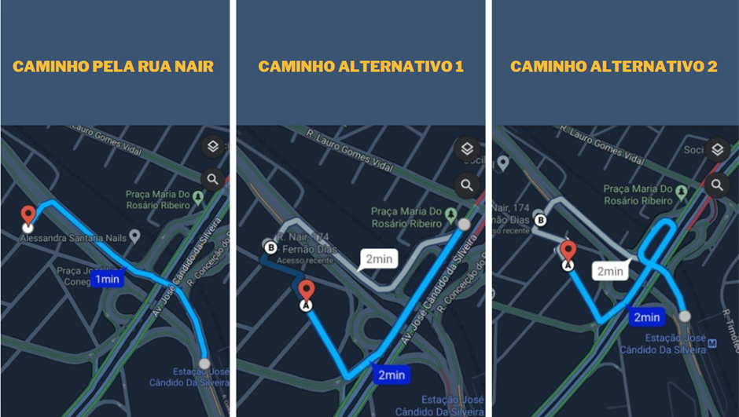

Comparação do tempo de deslocamento dos caminhos existentes para o Bairro União - Imagens de rotas por aplicativos

Por isso, fica patente que outros trajetos atendem a contento os propósitos de ligação mencionados pela BHTRANS e ninguém será prejudicado de forma relevante, não mais do que as vidas colocadas em risco por insistirem em manter uma travessia tão perigosa.

2- Resposta apresentada pela BHTRANS: “Quando da futura implantação de rota de transporte coletivo ao longo da Via 710, este ponto de atravessamento possui potencial para a atração de demanda;”

Este argumento apresentado pela BHTRANS carece de sentido e na verdade reforça o pleito que temos feito neste inquérito civil. Afinal, se nenhuma intervenção for feita na travessia, qualquer nova rota de transporte coletivo ao longo da Via-710 irá resultar em mais pessoas expostas à situação de risco quando tiverem que atravessar pela travessia em ponto cego.

3- Resposta apresentada pela BHTRANS: “Levando em consideração que o longo trecho da Via 710 entre a Avenida José Cândido da Silveira e a Rua Artur de Sá (próxima ao CENTERMINAS SHOPPING) não possui interseções em nível, exceto com a Rua Nair, o que se transforma em um indutor para o excesso de velocidade pelos condutores que lá transitam, em ambas as pistas foram instalados dispositivos eletrônicos a cada 200,00m (duzentos metros), aproximadamente, nos primeiros 600,00m (seiscentos metros) a partir da Estação José Cândido da Silveira em direção à Avenida Cristiano Machado, sendo três travessias de pedestres semaforizadas e um dispositivo de fiscalização eletrônica de velocidade (radar). Este conjunto de dispositivos, além de criar pontos mais seguros para a travessia de pedestres e fazer a conexão entre os dois lados das vias que são cortadas pelo Corredor, permitem o controle da velocidade operacional da via através do sincronismo dos respectivos dispositivos.”

Antes de tudo é importante registrar que a redação apresentada pela BHTRANS pode levar a equívocos de entendimento.

Devemos ressaltar que desde a conclusão da Via-710, no trecho citado de aproximadamente 600m a partir da estação José Cândido da Silveira não houve nenhum tipo de nova intervenção visando diminuir ou controlar a velocidade dos carros.

Na verdade, houve sim um retrocesso neste controle. Até 2017, pouco antes da construção da ciclovia, havia câmeras de controle de avanço de semáforo e de velocidade logo no primeiro semáforo em frente à estação José Cândido da Silveira, as quais foram suprimidas com a construção da ciclovia e com a complementação da Via-710.

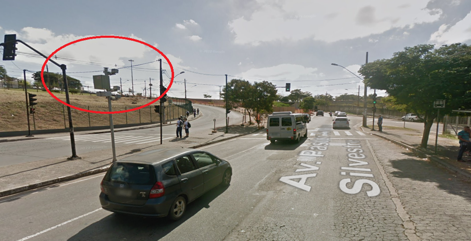

Controle de avanço de semáforo em 2017 - Imagem Google Maps

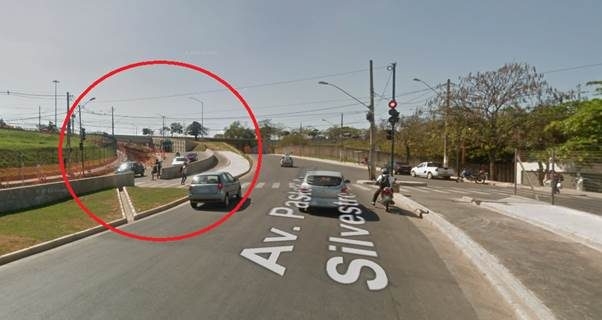

Controle de avanço de semáforo suprimido após a construção da ciclovia em 2018 - Imagem Google Maps

Ou seja, dos três semáforos citados pela BHTRANS, o único que existia antes da abertura da avenida Pastor Anselmo Silvestre, teve um importante dispositivo de controle de velocidade **<u>SUPRIMIDO</u>**.

Já os outros dois semáforos citados foram instalados após o viaduto da José Cândido da Silveira, em 2022, quando da abertura da Via-710.

Por isso, esses dispositivos eletrônicos não podem ser considerados como um fator de controle adicional de velocidade feito agora pela BHTRANS, como parece sugerir a redação dos técnicos.

Por fim, o dispositivo de fiscalização eletrônica mencionado pelos técnicos da BHTRANS também só foi colocado quando da abertura da Via-710. O problema é que este radar não acrescenta nenhuma segurança à travessia em ponto cego, pois ele foi colocado **<u>APÓS</u>** a perigosa travessia a mais de 100m de distância.

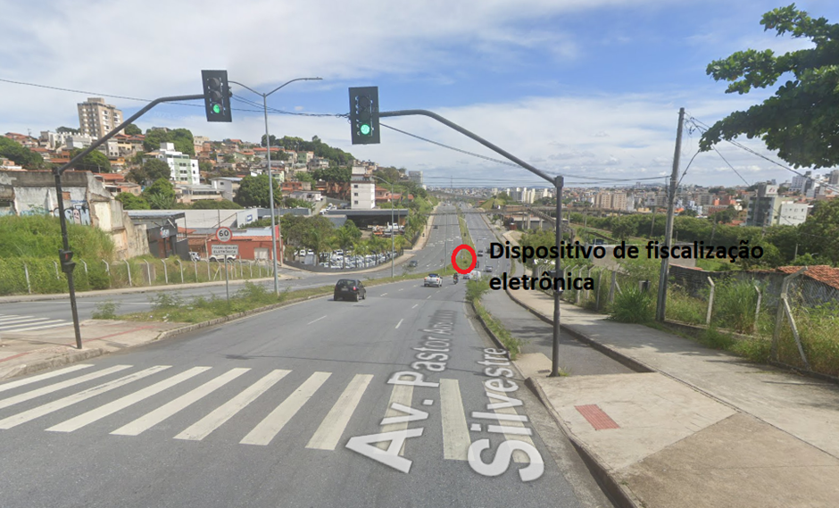

Dispositivo de fiscalização eletrônica colocado a mais de 100m de distância após a travessia da morte - Imagem: Google Maps

Ademais, a velocidade máxima de 60km/h permitida na via é muito acima do necessário para garantir segurança na travessia sem visibilidade.

Desta forma, fica claro que as considerações apresentadas pela BHTRANS carecem de fundamento e na verdade adicionam um elemento agravante, pois os responsáveis pela obra optaram por **<u>RELAXAR</u>** os controles de velocidade quando da retirada do radar com a abertura da Via-710.

**<u>3- Das intervenções propostas pela BHTRANS:</u>**

Nenhuma das intervenções apresentadas soluciona os problemas relatados e algumas agravam a situação de insegurança.

**Propostas 01, 02, 05 e 06 (Aumento da altura de sustentação dos semáforos, reforço da quantidade de focos semafóricos, reforço de sinalização horizontal e vertical)**

O grande equívoco de todas as intervenções apresentadas pela BHTRANS é que elas se fundamentam na crença de que as infrações de trânsito são cometidas em sua maior parte por uma suposta falta de visibilidade da travessia pelos motoristas e que bastaria aumentar os sinais de aviso para que as infrações diminuam.

A proposta feita no item 01 é ilustrativa desse ponto: “Aumento da altura das bases de sustentação dos semáforos veiculares projetados na pista em direção à Av. Cristiano Machado, eliminando qualquer ponto cego (local onde há prejuízo da visibilidade pelos condutores)” (Redação da BHTRANS com grifo nosso).

Pois bem, a tal elevação anunciada pela BHTRANS não passou de um acréscimo irrelevante de 30 cm na altura do semáforo.

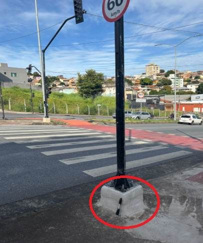

Elevação irrelevante do dispositivo semafórico

Acreditamos que as imagens falam por si e dispensam comentários.

Mas o ponto importante a se destacar aqui e nas outras propostas de intervenções apresentadas é que elas se fundamentam em três erros conceituais básicos.

O primeiro e mais importante é desconsiderar que o objetivo principal do poder público deve ser eliminar qualquer ponto cego na **PERSPECTIVA** de pedestres e ciclistas. Afinal, para garantir maior conforto e segurança, quem atravessa a rua também precisa manter contato visual com os veículos que se aproximam.

Neste momento, vale a pena recuperar o pedido da promotoria: “Avaliação da possibilidade de deslocamento do semáforo atualmente existente na Rua Nair com Via-710 para **ponto de maior visibilidade para motoristas, <u>ciclistas e pedestres</u>**, bem como de registro de avanço, ou outra medida que garanta a segurança da trafegabilidade no local” (Pedido da promotoria com grifo nosso)

Por isso, insistimos à promotoria do MPMG para notar que os técnicos e gestores da BHTRANS ignoram essa premissa básica, descumprem o que lhes foi exigido no pedido anterior do Ministério Público e apresentaram propostas apenas voltadas para visibilidade dos motoristas.

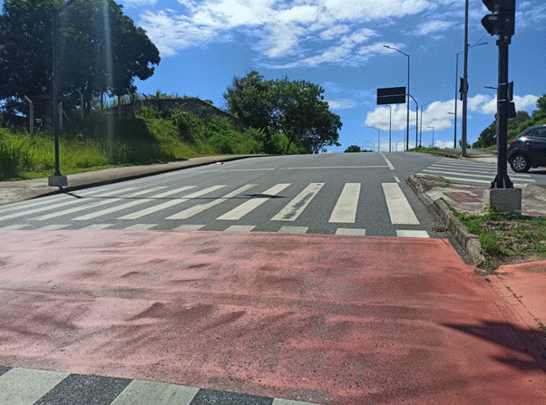

A perspectiva de visão que os técnicos e gestores da BHTRANS insistem em ignorar. Por conta do aclive, ciclistas e pedestres não conseguem enxergar a aproximação de veículos - Imagem: Cristiano Scarpelli

O segundo erro conceitual básico dos técnicos da BHTRANS é acreditar que os motoristas (ou pelo menos uma parcela representativa) são campeões de consciência cívica, de forma que são todos fiéis cumpridores das leis de trânsito.

Entretanto, as evidências apontam que nem todos abraçam o cumprimento da Lei, ainda mais quando envolve preocupações triviais do dia a dia, como atrasar uma encomenda, chegar mais tarde num compromisso ou diminuir seu tempo de lazer.

Por isso, estudos demonstram que fiscalização ostensiva, ameaças punitivas e redesenho das vias é o que há de mais eficiente para coibir infrações e aumentar a segurança viária.

O terceiro erro conceitual é um desdobramento do segundo. Na medida em que os técnicos da BHTRANS acreditam que os motoristas são anjos a cumprir fielmente os regramentos de trânsito, eventuais infrações só poderiam ocorrer por erro ou distração.

Assim, os técnicos da BHTRANS querem nos fazer crer que os reiterados avanços de sinal já devidamente comprovados em diversos semáforos estariam a ocorrer apenas por falta de avisos mais chamativos.

Para que isso fosse verdade, também seria preciso que a grande maioria dos motoristas não conhecessem a região. Entretanto, quem passa pela primeira vez tende a ser minoria e geralmente com conduta mais cuidadosa, enquanto quem desenvolve habitualidade, conhece melhor os riscos sancionatórios e pode relaxar no cumprimento das leis de trânsito, se achar conveniente.

Ademais, mesmo entre quem se propõe a cumprir as regras de trânsito e desenvolve habitualidade, erros, cansaço e desatenção continuam existindo, de forma que a segurança de quem atravessa não pode depender apenas de eventual e incerta boa consciência dos motoristas.

Por último, para terminar de desconstruir essas crenças da BHTRANS basta caminhar por qualquer rua em Belo Horizonte e constatar que os veículos desrespeitam diuturnamente semáforos por toda a cidade.

**Proposta 03 (Alteração do sincronismo dos semáforos)**

Essa proposta repete os equívocos conceituais anteriores e por isso os técnicos a estendem aos outros dois semáforos existentes da estação José Cândido da Silveira até a travessia da morte.

Essa crença é facilmente desmontada por [este vídeo](https://drive.google.com/drive/u/0/folders/1iOI9Q4miLoAABEJKhg7kplhLRAKcNrx-)<a href="#_ftn2" id="_ftnref2">[2]</a> que gravamos no segundo semáforo, onde o problema de avanço de sinal se repete de forma reiterada, inclusive com avanços de caminhões e ônibus, como pode ser visto nas imagens abaixo.

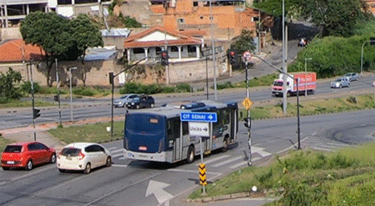

Ônibus avançando o semáforo que antecede a travessia da morte - Vídeo gravado por Cristiano Scarpelli

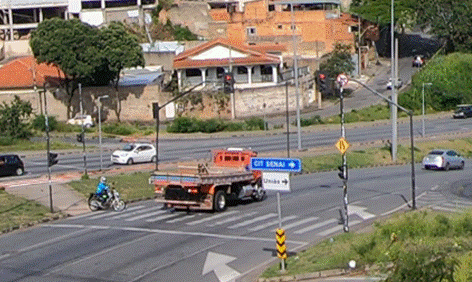

Caminhão e moto avançando o semáforo que antecede a travessia da morte - Vídeo gravado por Cristiano Scarpelli

Vale a pena recuperarmos a redação dos técnicos da BHTRANS: “Como há um maior respeito pelos condutores neste local, quando o semáforo da Rua Nair der o direito de passagem para os pedestres e ciclistas, a **<u>aproximação de veículos neste local será reduzida</u>**;” (Resposta da BHTRANS com grifo meu)

Portanto, os vídeos que gravamos no local fora de horário de pico e por apenas 30 minutos derrubam completamente esta tese, pois mostram dezenas de avanços no semáforo que antecede a travessia da morte.

Se não bastasse, o fluxo advindo da José Cândido da Silveira não pode ser desprezado. No mesmo período, [filmei e contei](https://drive.google.com/drive/folders/1U82ziYXlpW5vBtvEm4e4sL3l9Rb61jfD?usp=drive_link)<a href="#_ftn3" id="_ftnref3">[3]</a> 146 veículos acessando a Via-710, o que adiciona mais perigo à travessia em ponto cego.

Ademais, vale destacar que 146 veículos é quase seis vezes maior do que o número de veículos que acessaram a rua Nair pelo mesmo período. Desta forma, acreditamos que cabe indagar aos técnicos da BHTRANS, por que um fluxo 6 vezes maior foi desprezado, enquanto um fluxo baixíssimo de conversão para a rua Nair foi dado como inegociável?

**Proposta 04 (Botoeira)**

Essa é a pior intervenção possível, pois não adiciona nenhuma segurança e aumenta os riscos, pois reforça o sentimento de passagem livre aos motorizados, é pouco visível, amigável e conhecido por ciclistas e pedestres e ainda mais importante, é notório que a botoeira apresenta defeitos de forma recorrente.

Mais uma vez, vale a pena andar pela cidade para constatar que a maioria das botoeiras não funcionam. Isso pode ser testemunhado na própria Via-710, onde a botoeira instalada na curva da morte, na rua Conceição do Pará 930, ficou sem funcionar durante um período do ano passado, como pode ser visto neste [vídeo](https://www.instagram.com/reel/C3zwr93OeaiMF8fKmt8Fkv0BjBgA0FLOjv9Bl00/)<a href="#_ftn4" id="_ftnref4">[4]</a>.

Já este ano, no momento em que escrevo este parecer, ela está sem [botão para apertar](https://drive.google.com/drive/folders/1T9W_A5nu-A7_41D76mRHxxIw7xlkqknQ?usp=drive_link)<a href="#_ftn5" id="_ftnref5">[5]</a>, comprovando que defeitos e danos desse aparelho são a regra.

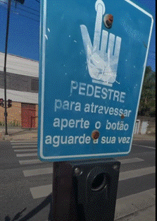

Botoeira sem botão na Via-710

Sabendo da notória disfuncionalidade desse aparelho, fico a me indagar se essa intervenção não foi feita apenas para diminuir de forma artificial a constatação irrefutável que [apresentamos no último parecer](https://drive.google.com/drive/folders/1iOI9Q4miLoAABEJKhg7kplhLRAKcNrx-)<a href="#_ftn6" id="_ftnref6">[6]</a>, onde contamos 144 infrações de trânsito por avanço de sinal em apenas 15 minutos de sinal vermelho, o que resultou numa média de 2 a 3 infrações por ciclo semafórico?

Além disso, novamente sem qualquer comprovação, os técnicos da BHTRANS afirmam ter notado que quando da existência de pessoas nas calçadas, os carros respeitam o semáforo: “Notamos que, quando da ausência de pedestres e ciclistas aguardando para iniciarem o atravessamento da pista em direção à Av. Cristiano Machado, alguns condutores desrespeitavam o sinal vermelho a eles destinado. Mas quando da existência dos mesmos na calçada ou no canteiro central, passa a ter o respectivo respeito por parte dos condutores”. (Resposta da BHTRANS com grifo nosso)

Convidamos a promotoria a verificar os vídeos que separamos [nesta pasta](https://drive.google.com/drive/u/0/folders/1E-uLydj0pauEo5tdBasmYoBGYWaDwfwk)<a href="#_ftn7" id="_ftnref7">[7]</a>, os quais provam que a narrativa apresentada pelos técnicos da BHTRANS não corresponde à realidade dos fatos.

Interessante destacar que a certeza de impunidade é tão grande, que os condutores avançaram o semáforo, mesmo vendo que um pedestre atravessava na sua frente e gesticulava para parar. No outro caso, o avanço ocorreu enquanto o ciclista atravessava e filmava a infração.

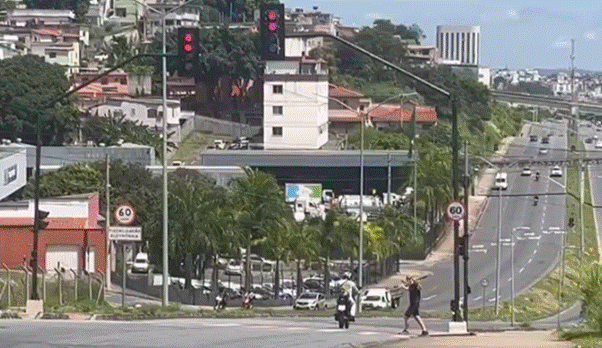

Certeza de impunidade 1: Motoqueiro avança sinal vermelho enquanto pedestre atravessa e gesticula para parar.

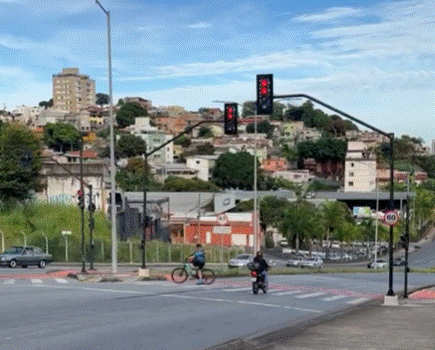

Certeza de impunidade 2. Avanços de semáforo ocorrem até mesmo com pessoas atravessando e com os infratores sabendo que estão sendo filmados - Imagem: Cristiano Scarpelli

**<u>4- Soluções efetivas</u>**

**A)** **Curso de capacitação para os técnicos da BHTRANS**

Antes de detalharmos as soluções viárias que consideramos efetivas, acreditamos que pode ser proveitoso inserir os técnicos e gestores da BHTRANS (em especial os que assinaram o relatório técnico anterior) em algum programa de educação com vivências experimentais de situações que reproduzam a **<u>PERSPECTIVA</u>** de pedestres e ciclistas.

Esse tipo de pedagogia tem sido aplicada [com motoristas de ônibus](https://www.agenciabrasilia.df.gov.br/2023/08/18/motoristas-de-onibus-vivem-a-experiencia-de-ser-ciclista-no-transito/)<a href="#_ftn8" id="_ftnref8">[8]</a>, para que possam “sentir na pele”, os perigos das chamadas finas educativas e tem tido bons resultados.

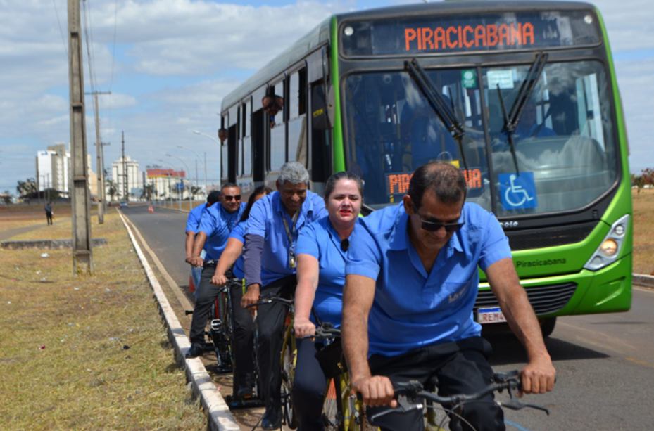

Treinamento “Motorista Amigo do Ciclista” para motoristas experimentarem a sensação de estar no lugar dos ciclistas quando são ultrapassados por um ônibus em alta velocidad - Foto: Divulgação/Semob

Talvez, para que os técnicos da BHTRANS consigam desenvolver uma melhor sensibilidade para o perigo envolvido em manter a travessia em ponto cego, um curso de capacitação poderia ser desenvolvido, permitindo uma vivência prática dos diversos riscos vivenciados pelos usuários não motorizados.

Por exemplo, para melhor reproduzir a diversidade de situações e riscos existentes, os técnicos poderiam ser colocados para atravessar várias vezes empurrando uma bicicleta, atravessarem sentados numa cadeira de rodas ou com algum limitador de deslocamento amarrado às pernas (a fim de tentar reproduzir limitações de PCD’s, idosos e crianças).

**B)** **Mudança do local da travessia:**

Essa é a intervenção mais importante e que realmente pode resolver o problema. As evidências de insegurança na travessia da morte são incontestáveis e ao contrário do que os técnicos da BHTRANS tentam fazer crer, elas não derivam de uma falta de sinalização ou desatenção dos motoristas.

Podem colocar avisos gigantes que ainda assim, um número considerável de veículos continuará a desrespeitar o semáforo, vidas continuarão em risco e o desconforto de quem atravessa continuará presente.

Por tudo isso, consideramos primordial que a travessia seja deslocada uns 60 metros acima da atualmente existente, mais precisamente uns 5 metros à frente deste poste.

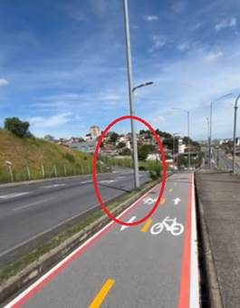

Sugestão de novo ponto de travessia na Via-710

Essa proposta transfere o semáforo para a parte plana da avenida, permitindo que transeuntes visualizem melhor os veículos dos dois lados e possam atravessar com mais conforto e segurança em qualquer direção.

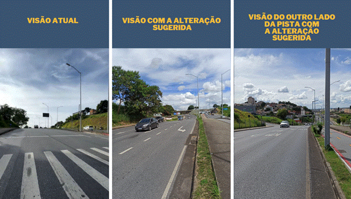

Comparação das visões de travessia. Visão atualmente existente (1), com a alteração sugerida (2) e do outro lado da pista (3)

Ademais, consideramos opcional a supressão do semáforo de conversão na Rua Nair.

Caso queiram evitar dois semáforos em sequência, ficou provado neste parecer que o semáforo da Rua Nair é dispensável, pois tem uso irrelevante e já existem alternativas de trajeto satisfatórias no entorno.

Mudar de lugar o semáforo da subida também não afetaria em nada os veículos motorizados e até ajudaria no acesso à Rua Nair.

Entretanto, caso por algum motivo ainda não explicado, a BHTRANS entenda essencial manter o semáforo de baixíssimo uso da rua Nair, não parece haver grande prejuízo em manter o dispositivo.

O único pequeno inconveniente é que o semáforo da rua Nair ficará a 50m de distância do novo semáforo colocado acima.

Todavia, exemplos de semáforos seguidos não faltam pela cidade, como ocorre na Afonso Pena em frente ao TJMG, onde é possível observar 3 semáforos numa distância de apenas 50 metros.

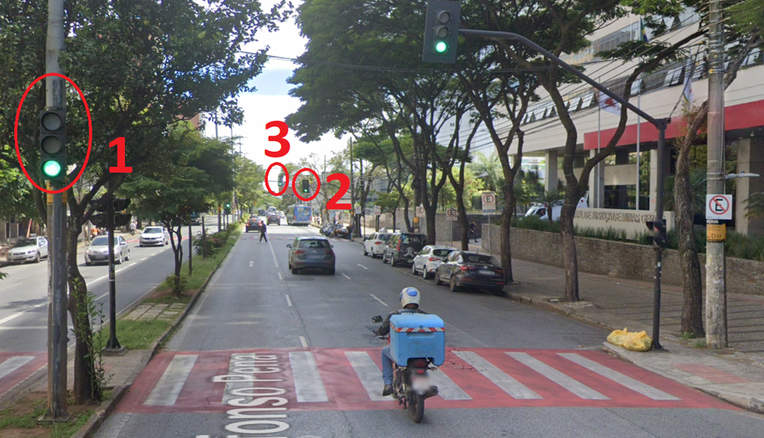

03 semáforos em sequência em frente ao TJMG na Afonso Pena- Imagem: Google Maps

Algo similar ocorre com os semáforos de chegada da Silviano Brandão na Andradas.

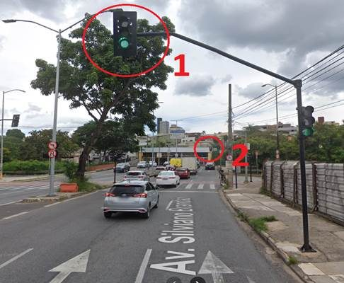

02 semáforos em sequência na Silviano Brandão com travessias a 40m de distância - Imagem: Google Maps

O importante em casos assim é manter um sincronismo entre os semáforos, de forma que funcionem de forma simultânea.

**C)** **<u>Redutor de velocidade</u>**

Independente da mudança de local do semáforo, a instalação de redutores de velocidade após o semáforo do viaduto da José Cândido da Silveira também seria uma iniciativa muito bem-vinda.

É importante pontuar que desde o início deste inquérito civil apontamos para a necessidade de instalação de semáforos e redutores de velocidades em duas outras travessias muito perigosas da Via-710.

Inicialmente, a BHTRANS se recusou a implementar redutores em todos os trechos demandados, com o argumento de que não seriam permitidos pelo art. 94 do CTB.

Entretanto, este mesmo artigo admite exceções e nosso trabalho de denúncia e produção de vídeos sobre os perigos existentes na Via-710 convenceram a prefeitura sobre a importância deste dispositivo antes da curva da morte na Rua Conceição do Pará 930 e perto do Batalhão de Polícia.

Portanto, o precedente já existe e demonstra a falta de validade dos argumentos anteriormente apresentados pela BHTRANS. Vale ressaltar ainda que as condições de perigo da travessia em ponto cego são similares àquelas onde foram colocados redutores.

**D)** **<u>Dispositivo eletrônico de fiscalização</u>**

A BHTRANS argumenta que possui um número limitado de dispositivos eletrônicos de fiscalização e que por isso adotou como critério de validação para colocação do dispositivo, a necessidade de pelo menos 10 sinistros de trânsito registrados em Boletins de Ocorrência.

Vale registrar algumas limitações desse critério. Na nossa demanda anterior para colocação de semáforo, radar e redutores na curva da morte na Via-710, a mesma justificativa foi dada durante anos.

Neste período, construímos um robusto banco de dados com fotos e registros em vídeos de diversos sinistros de trânsito graves ocorridos no local. Os moradores da região nos informaram que eram pelo menos de 2 a 3 sinistros de trânsito por semana.

Mas qual não foi nossa surpresa em constatar que pelos dados oficiais, quase não havia registros de sinistros no local e por isso a BHTRANS sempre nos respondia que nada poderia ser feito.

No nosso parecer anterior também alertamos sobre grave sinistro de trânsito ocorrido na travessia aqui debatida. Como vocês podem ver [nestes vídeos](https://www.instagram.com/p/C3qNWb6ueU9/?hl=pt)<a href="#_ftn9" id="_ftnref9">[9]</a>, o atropelamento de um ciclista ocorreu na travessia em ponto cego em 17/02/24 e vai ser interessante observarmos se esse fato irá constar nos registros oficiais.

Recuperamos este histórico para alertar que nem sempre os dados oficiais são representativos dos sinistros de trânsito que ocorrem pela cidade. Por diversos motivos, muitas pessoas preferem não registrar esses fatos.

E como essas motivações podem variar de localidade para localidade, nem sempre o critério é justo. Por exemplo, em locais em que os envolvidos sejam mais propensos a ter o veículo segurado, a motivação para registrar um B.O pode ser maior e o inverso ocorrer em locais de baixa renda.

Ademais, é importante lembrar que na medida em que as pessoas constatam o grande perigo em realizar a travessia num local sem visibilidade, uma parte dos pedestres acabam realizando a travessia mais acima.

Percebam que todos esses fatos prejudicam a validação e justeza do atual critério adotado pela BHTRANS.

Só que o mais importante desta discussão não é problematizar sobre o critério definido pela BHTRANS para destinação de uma ferramenta escassa e sim questionar por que este dispositivo é tão escasso?

Todo ano, a prefeitura destina farto volume de recursos públicos para obras viárias na cidade. No momento, algumas intervenções na Cristiano Machado e na alça de Nova Lima têm custo superior a R\$ 600 milhões.

Isso posto, seria interessante a BHTRANS nos informar qual o preço de um dispositivo de fiscalização eletrônica e se não seria o momento de redefinir as prioridades, destinando parte dos recursos de obras viárias para a aquisição de radares a fim de garantir maior segurança nas vias?

**<u>5- Conclusão</u>**

Considerando as diversas inconsistências apresentadas nos argumentos da BHTRANS, ora subestimando o elevado número de veículos que vem da José Cândido, ora superestimando o baixo número de veículos que fazem a conversão para a Rua Nair;

Considerando que a futura implementação da rota de ônibus na Via-710 poderá colocar mais pedestres em situação de risco na travessia em ponto cego;

Considerando que ficou provado a ocorrências de diversos avanços de sinal no semáforo anterior ao da travessia da morte e um volume expressivo de veículos que vem da José Cândido (inviabilizando a prometida sincronia);

Considerando que ficou provado que os avanços de semáforo continuam ocorrendo na travessia da morte mesmo com a presença de pedestres ou ciclistas na travessia e com o aumento irrelevante da altura do semáforo implementado pela BHTRANS;

Considerando que a substituição do ciclo semafórico normal por botoeira é disfuncional, pouco amigável e aumenta os riscos para pedestres e ciclistas;

Considerando que quando da abertura da Via-710 foram suprimidos aparelhos de controle de velocidade;

Considerando a permanência e agravamento dos riscos aos ciclistas e pedestres, apontados nesta notícia de fato;

Considerando que ficou provado não haver nenhum impedimento ou prejuízo na mudança de local da perigosa travessia em ponto cego para local mais seguro 60m acima da Rua Nair;

Considerando que diversos estudos pelo mundo demonstram que as medidas mais efetivas para diminuir a letalidade no trânsito são fiscalização, multa e redesenho das vias urbanas;

Sugerimos ao Ministério Público de Minas Gerais avaliar a celebração de um Termo de Ajustamento de Conduta (TAC) com a Prefeitura de Belo Horizonte, representada pela BHTRANS, SUDECAP, SUMOB e demais órgãos responsáveis, para que executem imediatamente a mudança do local de travessia na Via-710, junto à Rua Nair, para local com maior visibilidade para pedestres e ciclistas, sem prejuízo de medidas adicionais a garantir a redução de velocidade no local.

Nos colocamos à disposição para maiores esclarecimentos e cooperação.

------------------------------------------------------------------------

<a href="#_ftnref1" id="_ftn1">[1]</a> https://drive.google.com/drive/folders/1nz06A2bMswuYhJRoatz6DGMYOqUY335M?usp=drive_link

<a href="#_ftnref2" id="_ftn2">[2]</a> <https://drive.google.com/drive/u/0/folders/1iOI9Q4miLoAABEJKhg7kplhLRAKcNrx-> (Nome do arquivo: “Fura sinal semáforo anterior”)

<a href="#_ftnref3" id="_ftn3">[3]</a> https://drive.google.com/drive/folders/1U82ziYXlpW5vBtvEm4e4sL3l9Rb61jfD?usp=drive_link

<a href="#_ftnref4" id="_ftn4">[4]</a> https://www.instagram.com/reel/C3zwr93OeaiMF8fKmt8Fkv0BjBgA0FLOjv9Bl00/

<a href="#_ftnref5" id="_ftn5">[5]</a> https://drive.google.com/drive/folders/1T9W_A5nu-A7_41D76mRHxxIw7xlkqknQ?usp=drive_link

<a href="#_ftnref6" id="_ftn6">[6]</a> https://drive.google.com/drive/folders/1iOI9Q4miLoAABEJKhg7kplhLRAKcNrx-

<a href="#_ftnref7" id="_ftn7">[7]</a> https://drive.google.com/drive/u/0/folders/1E-uLydj0pauEo5tdBasmYoBGYWaDwfwk

<a href="#_ftnref8" id="_ftn8">[8]</a> https://www.agenciabrasilia.df.gov.br/2023/08/18/motoristas-de-onibus-vivem-a-experiencia-de-ser-ciclista-no-transito/

<a href="#_ftnref9" id="_ftn9">[9]</a> <https://www.instagram.com/p/C3qNWb6ueU9/?hl=pt>

https://www.instagram.com/p/C3dDnUCrb3l/?hl=pt
